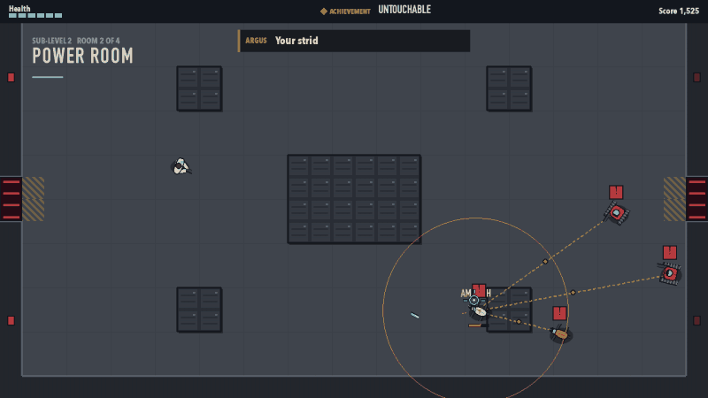

# BRAIN ROOM

Mohammed Hirez

CS4096 Artificial Intelligence for Games, University of Limerick

[Play BRAIN ROOM in your browser](https://brain-room.com/)

<picture>
  <source media="(prefers-reduced-motion: reduce)" srcset="images/fight.png">
  
</picture>

## What does this game do?

Brain Room is a top down shooter created with Pygame. The player is a scientist who has been locked inside a data center. The AI (ARGUS) that the player trained has taken control of the security robots, and ARGUS is uploading a copy of herself. The player must kill their way out of the data center to prevent ARGUS from completing her upload.
Brain Room will play in a web browser.

Most of my development work on Brain Room was done in regard to how the security robots were behaving. I wanted to make it so that there were two sentries in the same room that acted differently based off what they saw. One could see the player and begin to aim at them while the other sentry could be hidden behind a server rack and respond to the shot being fired. Since each robot sees the room independently, I can use the same code to give both sentries two completely different reactions.

The first room in Brain Room is the lobby. In the lobby, player movement is controlled with WASD keys, aiming is controlled with your mouse, and firing is controlled with your left click. The server racks break up the room into lanes allowing the player places to hide or seek cover. If a sentry sees an opportunity to shoot at the player, they are able to dash away from the players line of sight by pressing the shift key. After clearing all of the enemies in the room, the exit becomes open. Additional rooms add new types of enemy robots, including hounds that charge toward the player and menders that repair damaged robots. An area that gives good cover from a sentry may now provide bad cover if cornered by a hound.

## How Does the Robot Decide What To Do?

Once the game starts the Sentry will start walking around the room. At times it will stop to look around for you. The Sentry has to be able to "see" you. Whether you enter the room from straight ahead or from the side makes a significant difference. It could easily miss you when you enter because of a piece of equipment (such as a server rack) blocking its view, or it could simply take longer than normal for the Sentry to realize you were present. Once the Sentry realizes you are in the room, you should notice a question mark symbol on top of the Sentry. Once you are within the Sentry's view again, it will sound its alarm and other nearby Sentries will follow suit.

A Sentry will hear a gunshot (if fired by the player), and this gunshot will give the Sentry information about the direction in which you are located. When a Sentry is actively searching and sees gunfire, it will turn and move toward that location. However, if you have moved out of range before the Sentry arrives, it will simply go back to its original path.

Once a Sentry begins firing at you (or even begins attacking you), it has four possible actions:

1. Shoot at you (only one option).
2. Move left/right to position itself for a better shot (depending on the layout of the level).
3. Attempt to find a new vantage point to shoot from.
4. Seek cover.

For each of the above options I provided a numerical value representing how valuable that option is.
These values are used as input into the Sentry's decision-making process. For example, if both the Sentry and Player are in full health and the Sentry can get a clean shot at you, it probably wants to fire. On the other hand, if there is another robot standing directly in front of the Sentry's cannon, it won't matter what type of damage you sustained -- the Sentry will still receive a zero for shooting at you.

Moving lateral can provide a better angle for the Sentry to shoot at you. Damaged robots don't know they're damaged until after they've attempted to do something. They have two main things they must consider when deciding what to do next. First, damaged Sentries can use cover, but first they must identify a good spot to hide. The game will check all the surrounding squares to see if the player can see them. If none of the available spots work, the damaged robot will try an alternate plan of attack.

Additionally, although damaged Sentries may try to use cover for protection, there is a secondary consideration here also. Even though active, each course of action receives an extra score based upon whether it is currently applicable. Therefore, a damaged robot is less likely to switch between various plans of action in an endless loop before doing anything meaningful.

## Finite state machine implmentation of robots

Within the program, i have implemented a finite state machine (fsm) in order to keep track of all behaviors associated with each individual robot.

In general, each robot has knowledge about which "state" it is currently in (i.e., what activity it is doing at any given time - e.g. Patrol/Engage/Aim/Fire/etc.). Each robot will perform some type of behavior based on the "state" it is in during every iteration of the game loop. A transition in "states" happens once the robot meets certain requirements (e.g. Detects a player), to go into a new "state".

For example, an engaged Sentry robot detects a player and has a clear shot opportunity, so during its engage "state", the Sentry determines what actions to take.
Once the Sentry chooses to shoot, it goes into aim "state"; during aim, it stops moving and uses a red aiming line to follow the player.
Once the Sentry is close enough to complete aim "state", direction locking starts, then after aim state expires, it enters into fire "state"; during fire, it shoots 3 rounds back to back.
Finally, after fire "state" has expired, the Sentry returns to engage state. There is a short pause in this transition as well as before it will begin shooting again.

The above example shows how you can test this function in Lobby game mode by taking the following steps.

Step aside in early game and watch how the red aiming line follows your movements.
Do not move until direction lock has been completed prior to dodging around rounds fired.
Additionally, if you move behind a server rack before the direction lock is activated on the Sentry's aiming system, it will be unable to acquire a shot.
Lastly, if the Sentry continues to lose sight of the player for a longer than normal amount of time while continuing to attempt to shoot, it will cancel the shot and return to the engage "state".
