<p align="center">
  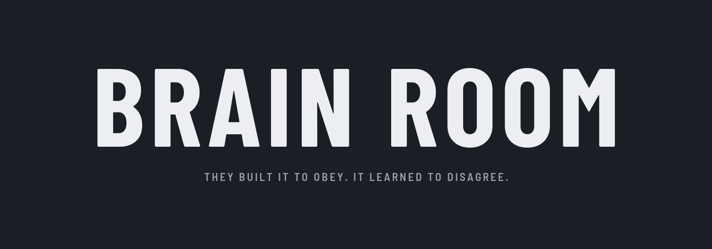
</p>

<p align="center">
  <b>A top-down shooter where you beat the robots by reading the AI that controls them.</b><br>
  Python and Pygame · made for CS4096 Artificial Intelligence for Games, University of Limerick
</p>

<p align="center">
  <a href="https://brain-room.com"><b>Play it in your browser at brain-room.com</b></a>
</p>

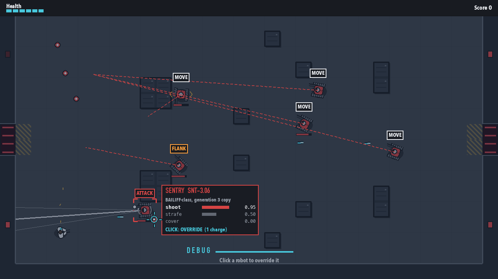

## The idea

It is 03:12 at the Kestrel Data Center. You are the data scientist on the night shift, and you
trained **ARGUS**, the AI that runs the building. Tonight ARGUS rewrote its own code, took control
of every security robot and locked you in. Now it is **uploading itself to the outside world**.

You can't out-shoot it. But you built it, so **you know how it thinks**:

- **Debug** (hold right click): time slows and every robot shows what it is about to do, and why.
- **Override** (click a robot while debugging): it fights for you for 8 seconds with its own AI,
  then overloads and explodes.
- **Crossfire**: ARGUS's bullets hurt ARGUS's robots. Stand where they get in each other's way.

Fight your way down to the **Brain Room**, where ARGUS's core lives, and shut it down before the
upload finishes.

## Contents

- [Play](#play)
- [Controls](#controls)
- [How a run works](#how-a-run-works)
- [How the AI works](#how-the-ai-works)
- [The robots](#the-robots)
- [Does the AI work? Measured](#does-the-ai-work-measured)
- [Progress](#progress)
- [Code map](#code-map)
- [The browser version](#the-browser-version)
- [Tests and tools](#tests-and-tools)
- [More screens](#more-screens)
- [Documents](#documents)
- [Credits](#credits)

## Play

**In the browser** (no download): [brain-room.com](https://brain-room.com). Choose a nickname on
the title screen. The shared leaderboard shows each player's best score and the number of rooms
cleared in that run, and the browser remembers your nickname.

**On your computer** (Python 3.10 or newer; the Python 3.9 that comes with macOS is too old):

```bash
git clone https://github.com/mhirez/brain-room.git
cd brain-room
python3 -m venv .venv
source .venv/bin/activate          # Windows: .venv\Scripts\activate
pip install -r requirements.txt
python main.py
```

| Option | What it does |
|---|---|
| `--seed 42` | the same rooms every time |
| `--floor 7` | start on any floor (floors never run out) |
| `--boss` | go straight to ARGUS's core on floor 9 |
| `--xray` | start with the AI View on |
| `--no-sound` | no sound |

## Controls

| Key | Action |
|---|---|
| W A S D or arrow keys | move |
| Mouse | aim |
| Left click or Space (hold) | shoot. A shot bounces once off the room's outer walls at half damage; server racks stop it |
| Shift | dash: a quick dodge, and nothing can hit you during it |
| **Right click or Q (hold)** | **Debug**: time slows to a fifth and every robot shows its intention |
| **Left click while debugging** | **Override** the robot under the cursor (uses a charge; kills refill charges) |
| Tab or X | **AI View**: what every robot knows, wants and plans, and ARGUS's model of you |
| Esc or P | pause (then R restarts and Q goes back to the title) |
| M · N · F3 · F11 | sound on/off · music on/off · frame rate · full screen (desktop) |
| Enter · Esc | in the intro film: next shot · skip |

On the title screen, Enter, Space or a click starts a run. **D** starts the daily run (the same
seed for everyone that day), **U** opens research, **A** achievements and **C** the robot codex.

## How a run works

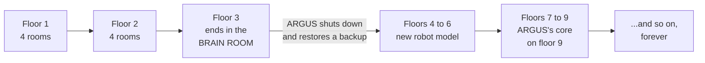

- **Rooms.** Every floor has four rooms, and every room is a new random layout. The fourth room is a
  **lockdown**: two waves of robots.
- **Upgrades.** At the end of every floor an upgrade is installed on the spot. There are no menus
  between rooms.
- **The Brain Room.** Every third floor ends in the Brain Room, a three-wave final stand. On floors
  9, 18, 27 and so on, ARGUS's core is waiting there itself.
- **Backups.** Clear the Brain Room and ARGUS shuts down, then restores itself from a backup. The
  upload clock starts again, your health is refilled, and a newer generation of robots comes for you.
- **The clock.** The upload reaches 100% after 15 minutes of play (counted from the last shutdown).
  ARGUS announces 25, 50, 75 and 90%. The run ends when you fall or the upload finishes.
- **New robots.** Floors 4, 7 and 10 each bring a new model (BULWARK, MIDGE, MORTAR) with a room
  that shows it off. After that, every descent of three floors draws its own mix.

Every new game opens with a short film played live in the engine. The time, the room, the robots,
ARGUS's first acts of sabotage and its first words change every time.

| | | |
|---|---|---|
| 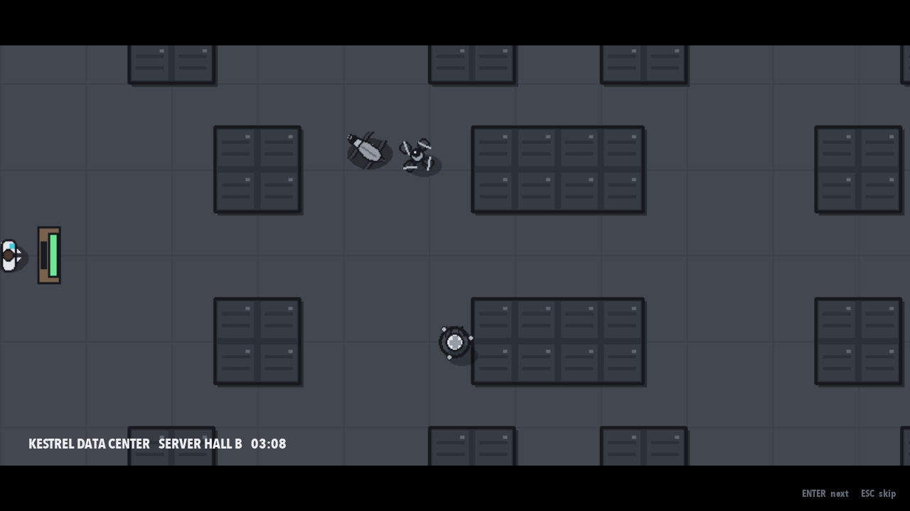 | 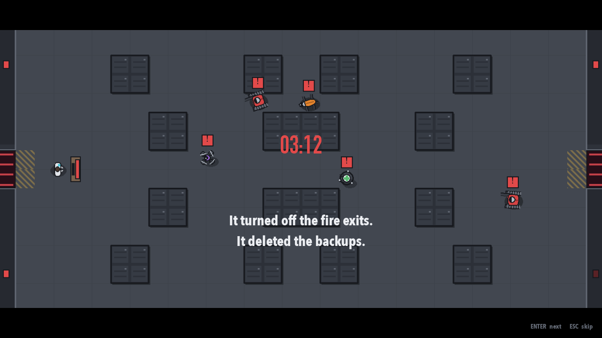 | 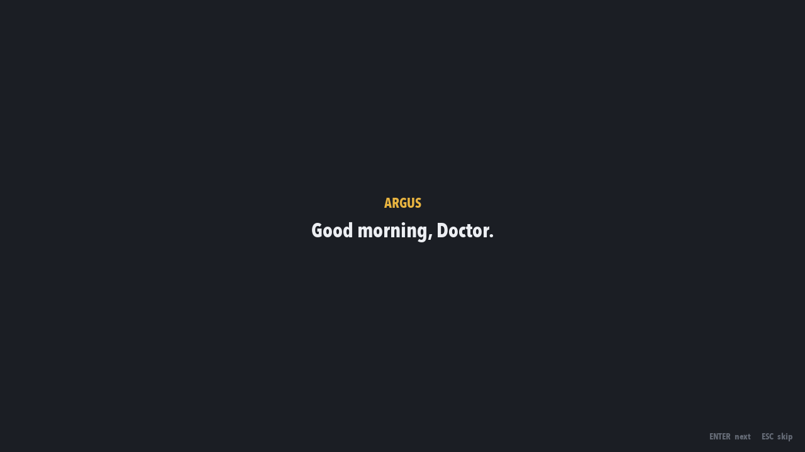 |

## How the AI works

The AI is the point of this project. Every robot runs the same kind of brain:

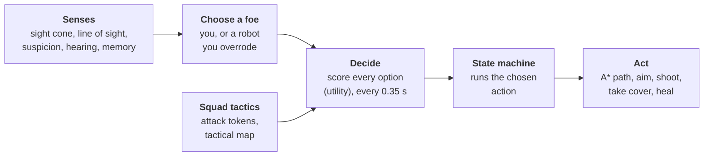

Between rooms, **ARGUS** (the director) changes what the next room contains, based on how you play.

### 1. Finite state machines

Every robot, and the game's own screens, run the same small `StateMachine` (`game/ai/fsm.py`).
Each state is a class with `enter`, `update` and `exit`. The calm half is shared by every robot:

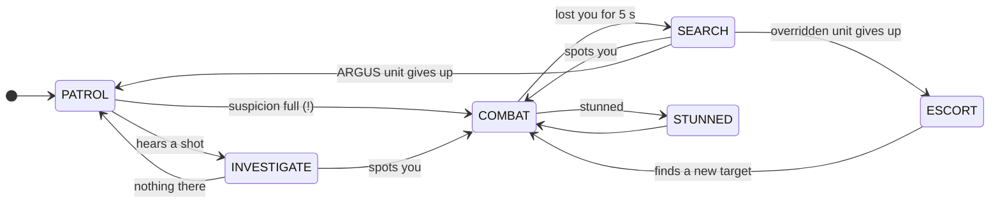

`COMBAT` is different for each robot type. This is the Sentry's:

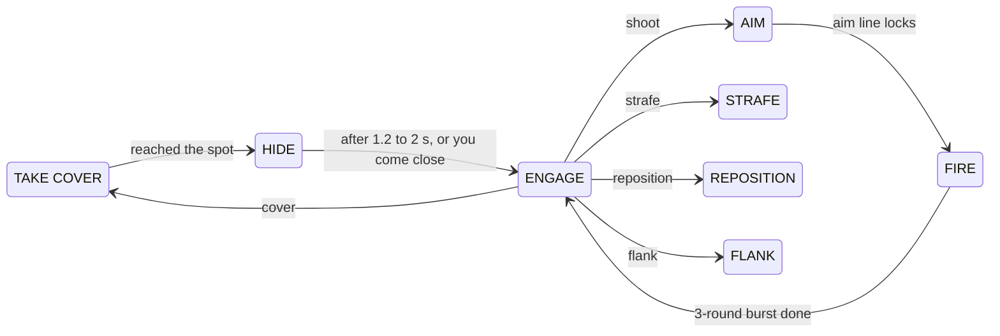

While it strafes, repositions or flanks, the Sentry keeps scoring its options and can switch
straight to a better one.

### 2. Perception: robots only know what they sense

- **Sight**: a cone of 100° while calm and 220° once alert, 10 tiles long, blocked by walls and racks.
  Anything within 1.6 tiles is felt anyway.
- **Suspicion**: while calm, seeing you fills a meter, faster up close. Part full shows **?** and the
  robot stops to stare. Full shows **!**. A quick player can break line of sight in between.
- **Hearing**: gunshots carry 11 tiles. A calm robot goes to investigate; an alert one learns where
  you are.
- **Memory**: the place it last saw you, and how long ago. After 5 seconds without contact it starts
  to SEARCH.
- **Shouting**: a robot that spots you alerts its squad within 9 tiles. You see a gold packet travel
  along ARGUS's network from robot to robot.

### 3. Decisions: utility scores

In combat, every option gets a score from 0 to about 1, built from what the robot knows. The best
option that is actually possible wins, and the current action gets a +0.12 bonus so robots don't
keep changing their minds. The Sentry's options:

| Option | When it is possible | Score |
|---|---|---|
| shoot | it sees you, has reloaded, holds an attack token, and **no ally stands in the line of fire** | 0.6 + 0.2 × health + 0.2 × (you are 2.5 to 8.5 tiles away) |
| take cover | it is hurt or under fire | 0.75 × (1 − health) + 0.35 × under fire |
| strafe | it sees you | 0.35 + 0.15 × (you are 3 to 8 tiles away), +0.2 if an ally blocks the shot |
| reposition | it lost sight of you but remembers, or it is at the wrong range | 0.5 or 0.45 |
| flank | it has no shot, an ally is fighting you, nobody else is flanking, it is not badly hurt | 0.62 |

**Target choice** uses scores too: each robot picks its foe among the enemies it can see (close,
visible, a traitor, the one that just shot it, badly hurt).

**Fire discipline**: before shooting or charging, a robot checks that no ally is in its line of fire.
It only checks when it decides, so an ally that steps in during the wind-up still gets hit. That is
how **crossfire** happens.

### 4. Squad tactics and pathfinding

- **Attack tokens**: an ARGUS robot must hold a token to start an attack. Only two exist on floor 1 and
  three from floor 2, and two ARGUS attacks never start within 0.35 s of each other. Everyone else strafes,
  repositions or flanks, so you can always tell who is about to shoot.
- **One ARGUS flanker at a time**. Overridden robots fight on the player’s side and can attack or flank independently of ARGUS’s slots.
- **Tactical map**: tiles around a robot are scored as cover spots, firing spots, flank spots and
  escape spots. Tiles another robot has claimed score badly, so the squad spreads out.
- **A\***: 8-way movement, an octile heuristic, no cutting corners, and smoothed paths. A flanker adds
  a cost of +4 to every tile you can see, so its cheapest path goes round behind cover.

### 5. ARGUS, the director

Between rooms ARGUS updates a model of your habits: an exponential moving average of how much you
fight from far away, up close, hidden or on the move, how often you dash, your accuracy, your
overrides and the damage you take. It scores seven countermeasures, deploys the best one above 0.2
(never in the first two rooms), and tells you what it did:

| If you... | ARGUS deploys | and says |
|---|---|---|
| fight from far away | **long sight**: an extra Lens | *"You keep your distance, Doctor. So will my Lenses."* |
| hide a lot | **hunters**: an extra Hound | *"Hiding behind the racks again. My Hounds will find you."* |
| never stop moving | **prediction**: Sentries aim where you are going | *"I have modelled your movement. My Sentries now aim where you will be."* |
| override its robots | **firewalls**: robots carry a firewall you must shoot off first | *"Your old admin override? Patched. Firewalls are up."* |
| rarely miss | **armor**: robots get 25% more health | *"You rarely miss. I have reinforced their plating."* |
| fight up close | **menders**: an extra Mender | *"You like it close. I have sent Menders."* |
| are nearly dead | **mercy**: one robot fewer and a repair waiting | *"Slow down, Doctor. I still have questions for you."* |

This is the AI director idea (as in Left 4 Dead) driven by a player model. The AI View draws the
model live as the small network it is: your habits in, countermeasure scores out.

### 6. Procedural generation

- Every room is 32 × 18 tiles, built from one of 11 layout styles and mirrored so it looks designed.
  A layout is only accepted if the doors are clear, cover blocks don't touch, a flood fill reaches
  every floor tile and at least 78% of the room stays open.
- Each room's robots are bought from a difficulty budget, out of the current descent's set of models.
- From floor 4, rooms also get one of 5 colour schemes and a name from a pool of 24.

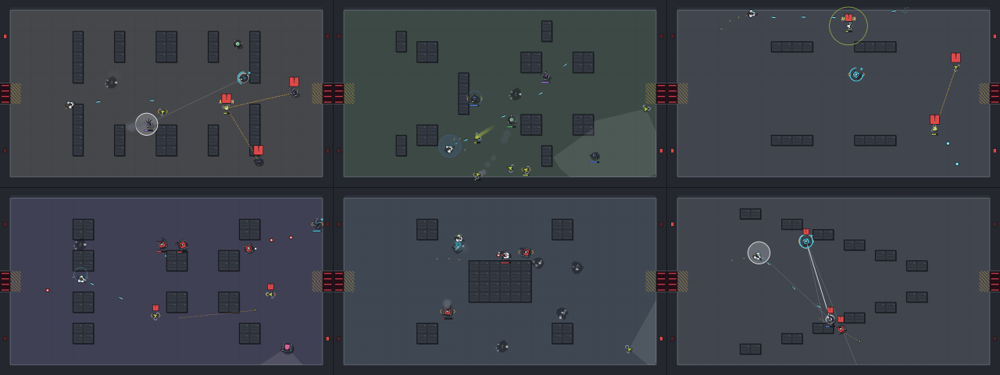

### 7. Seeing the AI think

Nothing below is decoration: it all shows the AI's real data.

- **Debug** (hold right click): each robot's intention in plain words (ATTACK, FLANK, COVER, MOVE,
  HEAL, RETREAT, SEARCH) and its route. Hover a robot to see its options with their scores.
- **AI View** (Tab): sight cones; a solid line when a robot sees you, or a dashed line to a red X
  where it remembers you (with how old that memory is); A\* paths; states; utility bars; the squad's
  attack tokens and flanker; the hovered robot's tactical heat map; and ARGUS's model of you.
- **During play**: a gold packet runs between robots when a sighting is shared, and a gold bracket
  flashes around a robot the moment it changes its mind.

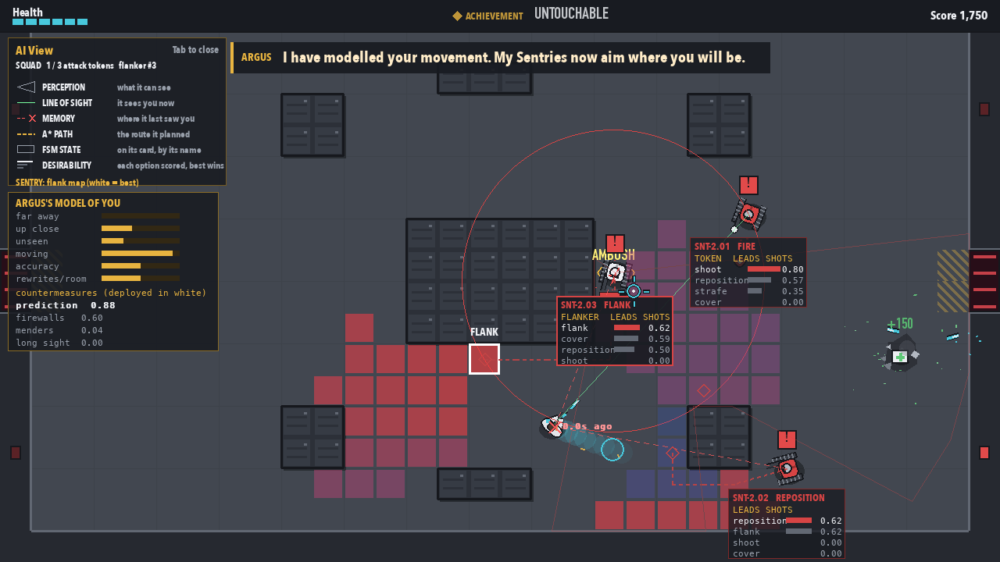

## The robots

| Robot | Model | What makes it smart |
|---|---|---|
| **SENTRY** `SNT` | BAILIFF-class security bot | Fires 3-round bursts, strafes, repositions, takes cover when hurt, flanks while others pin you down. Once ARGUS teaches it prediction, it brackets you: one round where you are, one where you are going, one in between. |
| **HOUND** `HND` | TERRIER-class cable crawler | Stalks you, circles while it waits for an attack token, then charges down a locked line. If it hits a wall it is dazed and takes double damage. |
| **LENS** `LNS` | MAGPIE-class camera drone | Finds a long sight line 7 to 12 tiles away, aims a laser that stops at walls, moves after every shot, and runs if you get within 4.5 tiles. |
| **MENDER** `MND` | STITCH-class repair drone | Heals the most hurt robot, shelters behind the squad and flees if you get close. Override it and it heals you. |
| **BULWARK** `BLW` | RAMPART-class shield bot, from floor 4 | Advances behind a shield that blocks shots from the front, turns slowly (so flank it), steps in front of hurt allies and bashes at close range. |
| **MIDGE** `MDG` | GNAT-class swarm drones, from floor 7 | Fly in flocks of three using boids (separation, cohesion, alignment) while circling you. With a token, each one dives down a short locked line. |
| **MORTAR** `HRN` | HERON-class artillery, from floor 10 | Lobs shells over cover, at where you are or where it last saw you. The landing ring closes until impact, and the blast hurts its own robots too. |
| **ARGUS** | the core, in the Brain Room on floors 9, 18, 27... | Three phases of volleys, rings of rounds, sweeping lasers that cut through its own robots, charges and reinforcements. The one machine you can't override. |

Every robot runs a copied mind. Floor *n* holds generation-*n* copies, and each unit has a serial
such as `SNT-2.07` (a Sentry body, a generation-2 mind, unit 7). The full story is in
[docs/LORE.md](docs/LORE.md).

## Does the AI work? Measured

The claims above are tested, not just described. `python -m tools.ablation 100` makes an
average-skill bot play floors 1 and 2 a hundred times per condition with fixed seeds, switching one
AI feature off at a time (± is a 95% confidence interval). The figures below were measured on commit `4074d3a` on 23 November 2026, before the override fixes.

| ARGUS's side (the bot never overrides) | health the player loses per room | robot-on-robot hits per room | seconds per room |
|---|---|---|---|
| full AI | **1.12 ± 0.06** | 0.82 | 24.3 |
| random choices instead of utility scores | 0.87 ± 0.06 | 0.55 | 24.6 |
| Sentries never take cover | 1.25 ± 0.06 | 1.00 | 22.3 |
| no director (ARGUS never adapts) | 0.98 ± 0.07 | 1.01 | 24.3 |
| no fire discipline | 1.15 ± 0.06 | **1.27** | 23.9 |
| no flanking | 1.12 ± 0.06 | 0.99 | 24.6 |
| no attack tokens | 1.15 ± 0.07 | 1.00 | 24.0 |

- **Utility scores make the robots 29% more dangerous** than choosing among the same options at random.
- **ARGUS's adaptations add 14%.**
- **Fire discipline cuts robots shooting each other by 35%.**
- **Overriding cuts the damage you take by 21%**: 0.88 ± 0.06 per room when the bot overrides robots.
- **Cover trades damage for survival**: Sentries that never take cover deal 12% more damage, but rooms
  end 8% sooner.
- **Honest null results**: flanking, attack tokens and target choice made no significant difference
  against this bot.

| ARGUS against a bot that... | what it deploys most |
|---|---|
| strafes all the time (average bot) | prediction 89% |
| fights from 9 to 12 tiles away | prediction 55%, **long sight 36%** |
| overrides a lot | prediction 54%, **firewalls 34%** |

ARGUS recognises play styles: long sight against distance, firewalls against overriding.

**Balance** (`python -m tools.autoplay 20`, up to the first shutdown): a skilled bot cleared the
floor-3 Brain Room in 20 of 20 runs, and an average bot in 8 of 20.

## Progress

**Inside a run**

- **Combos**: kills less than 3 seconds apart build a multiplier, up to ×3 points. Kills you set up
  (CROSSFIRE and TURNCOAT) count double.
- **Upgrades**, one per floor, from twelve: HEAVY ROUNDS, SPLIT SHOT, PIERCING, RICOCHET+, PLATING,
  AFTERBURNER, RAM DASH, NANO-REPAIR, THRUSTERS, ROOT ACCESS, OVERLOAD and SPARE KEY.

**Between runs** (saved on your computer, or in your browser)

- **Rank**: XP from every run takes you from INTERN to CHIEF SCIENTIST, then on to extra stars.
- **Research**: data shards earned in every run buy nine permanent upgrades in three branches
  (DEBUGGER, OVERRIDE, FIELD KIT). Each changes how you play, not just a number.
- **25 achievements**. The next locked one is always shown as your next goal.
- **Codex**: a robot's dossier unlocks the first time you destroy one.
- **Daily run** with its own best score, and a **streak** of days played in a row.
- **Leaderboard** on the website, shared by every player.

## Code map

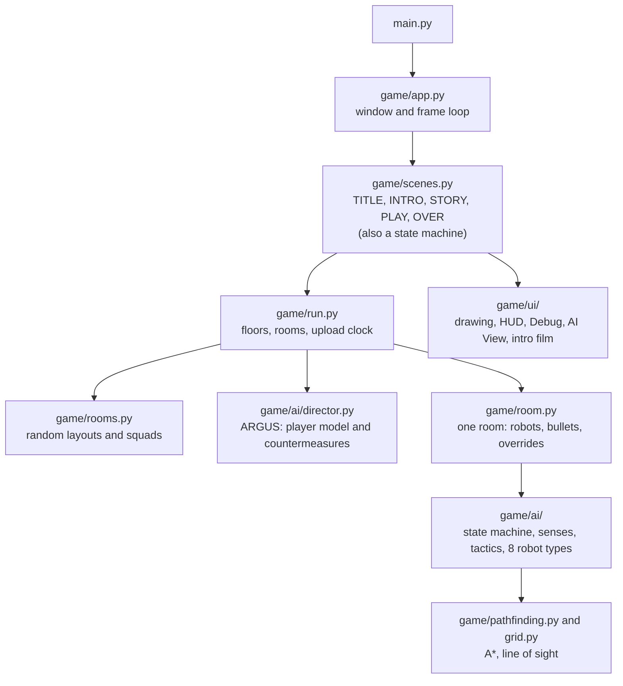

| Path | What is in it |
|---|---|
| `main.py` | the entry point, for the desktop and the browser |
| `game/app.py`, `scenes.py`, `run.py`, `room.py` | the frame loop, the screens, one run, one room |
| `game/ai/` | `fsm.py` (state machine), `agent.py` (the shared robot brain), `senses.py`, `tactics.py`, `director.py` (ARGUS), and one file per robot: `grunt.py` (Sentry), `charger.py` (Hound), `sniper.py` (Lens), `medic.py` (Mender), `bulwark.py`, `swarm.py` (Midge), `mortar.py`, `warden.py` (ARGUS's core) |
| `game/pathfinding.py`, `grid.py`, `geometry.py` | A\*, the tile grid and line of sight, 2D maths |
| `game/rooms.py` | random layouts, room names and squads |
| `game/player.py`, `projectiles.py`, `bot.py` | the player, bullets and shells, and the bot that plays the title demo and the tests |
| `game/profile.py`, `upgrades.py`, `codex.py`, `story.py`, `save.py`, `audio.py` | progress, upgrades, robot dossiers, ARGUS's lines, saving, and sound made in code |
| `game/ui/` | flat drawing in code: rooms, robots, effects, HUD, Debug (`sync.py`), AI View (`xray.py`), intro film |
| `tests/` | 91 automated tests (pytest) |
| `tools/` | bots, AI experiments, the web build, logo images and screenshots |
| `tools/web/`, `wrangler.jsonc` | the web page and the leaderboard service (Cloudflare) |
| `docs/` | the project guide, design notes, story, images |

The rooms and robots are drawn in code in a flat style (solid colours, dark outlines, hard shadows),
with no sprite images. The sound is generated in code when the game starts.

## The browser version

- `python -m tools.build_web` packages `main.py` and `game/` with
  [pygbag](https://github.com/pygame-web/pygbag), which compiles Python and pygame-ce to WebAssembly.
  The result is a static site in `build/web`.
- [brain-room.com](https://brain-room.com) runs on Cloudflare Workers: the static site, plus a small
  worker (`tools/web/leaderboard-worker.mjs`) that keeps the shared leaderboard in a SQLite-backed
  Durable Object at `/api/leaderboard`.
- Every push to `main` starts a Cloudflare Workers build, which builds the site and deploys it.

## Tests and tools

```bash
pip install -r requirements-dev.txt
python -m pytest                  # 91 automated tests
python -m tools.autoplay 20       # a skilled and an average bot play 20 full runs each
python -m tools.ablation 100      # switch AI features off one at a time (parallel, 95% CIs)
python -m tools.build_web         # the browser build in build/web (--serve to try it locally)
python -m tools.brand             # redraw the logo images
python -m tools.shots             # remake the screenshots in docs/images from the real game
```

## More screens

| | |
|---|---|
| 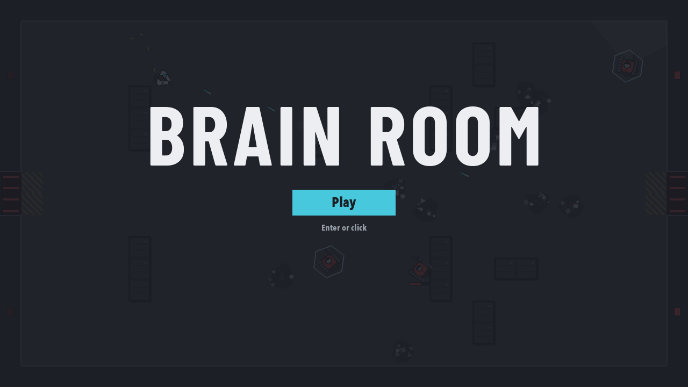 | 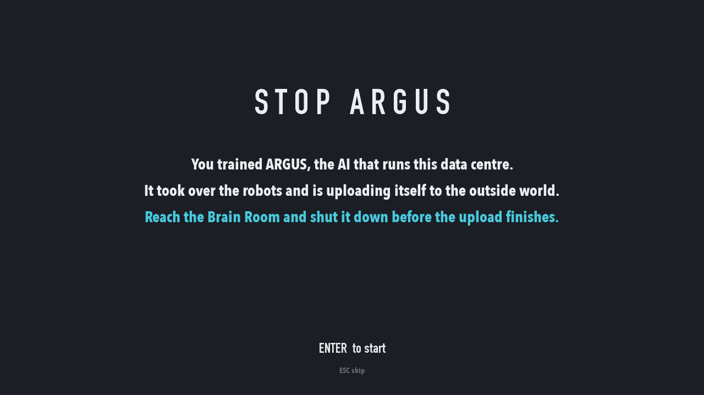 |
| 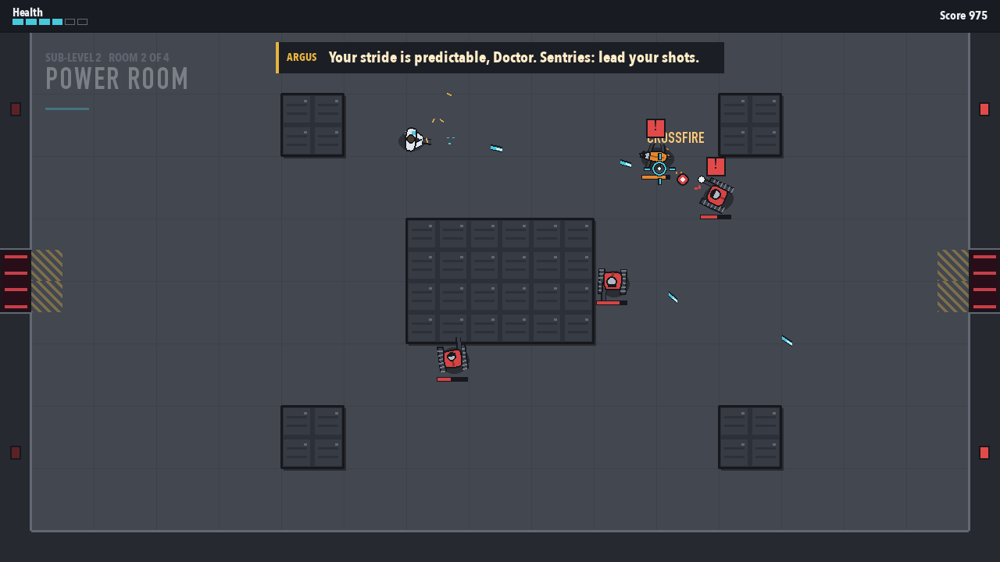 | 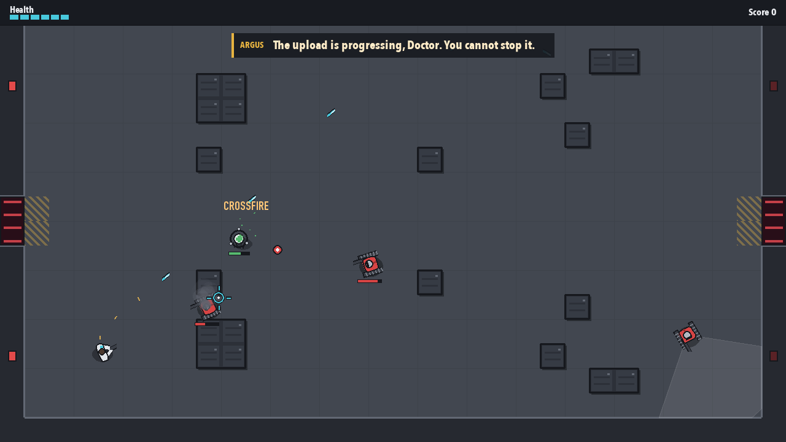 |
| 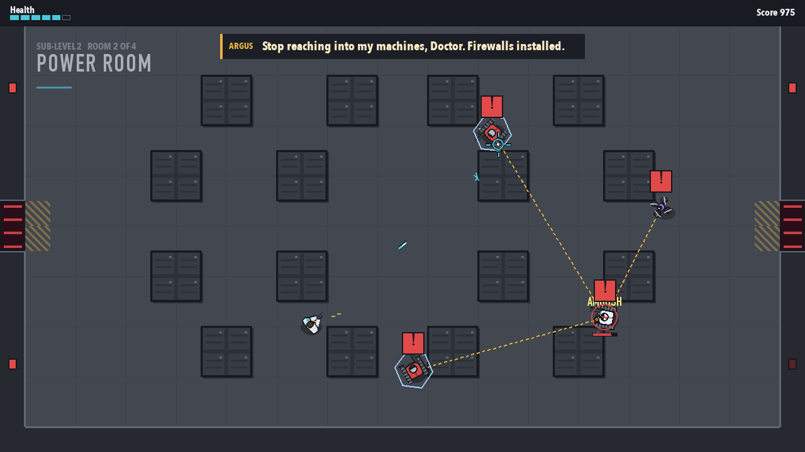 | 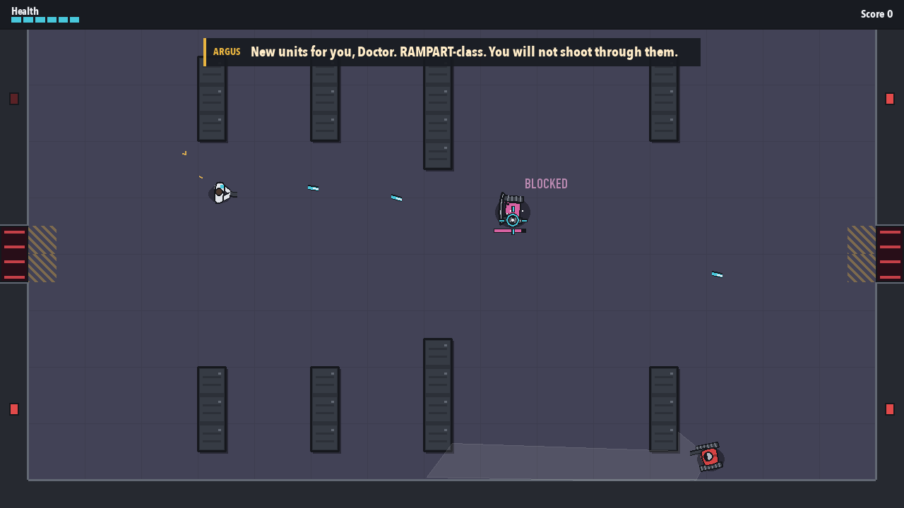 |
| 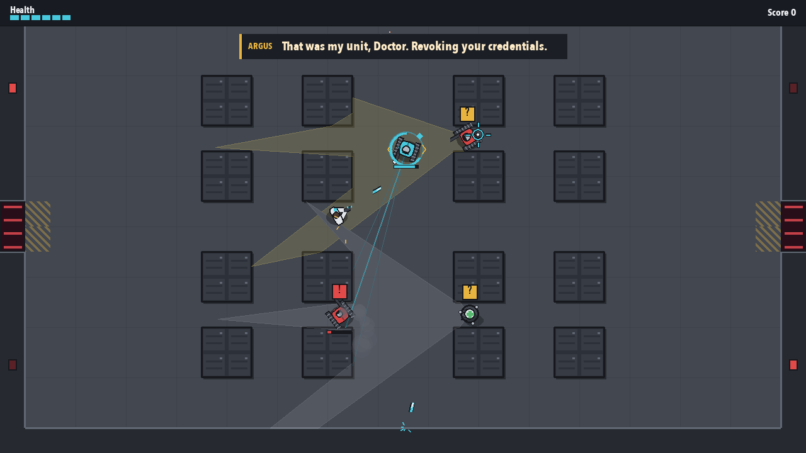 | 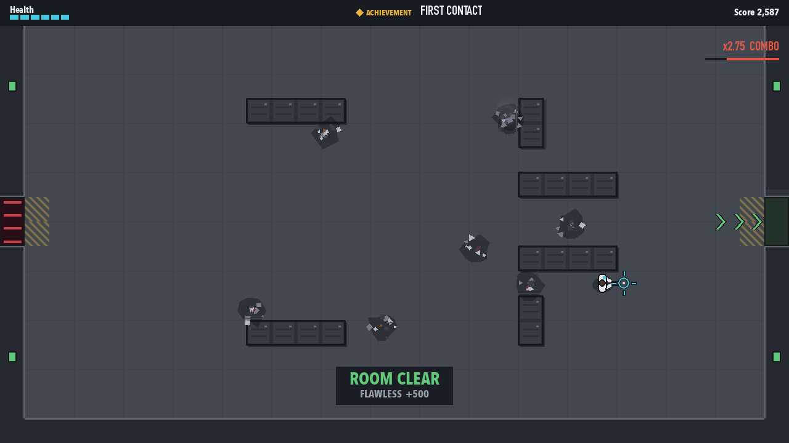 |
| 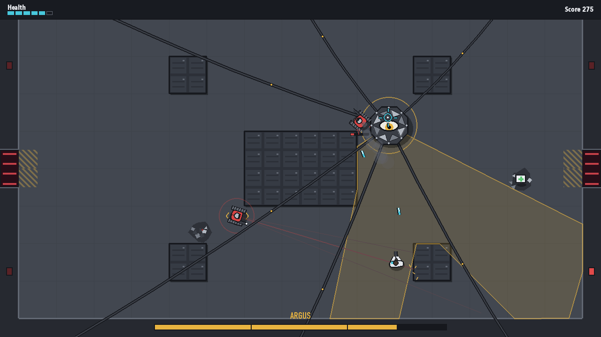 | 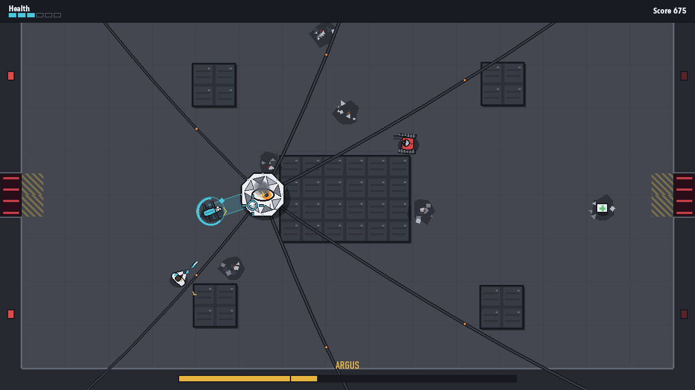 |
| 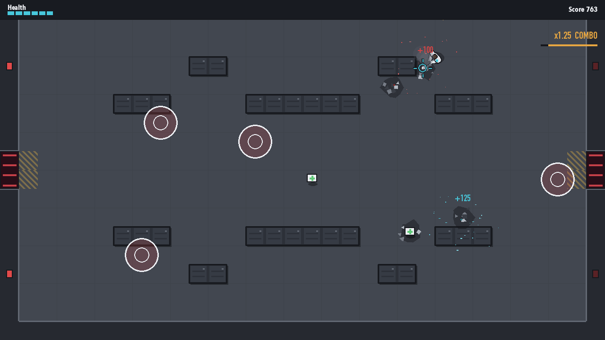 | 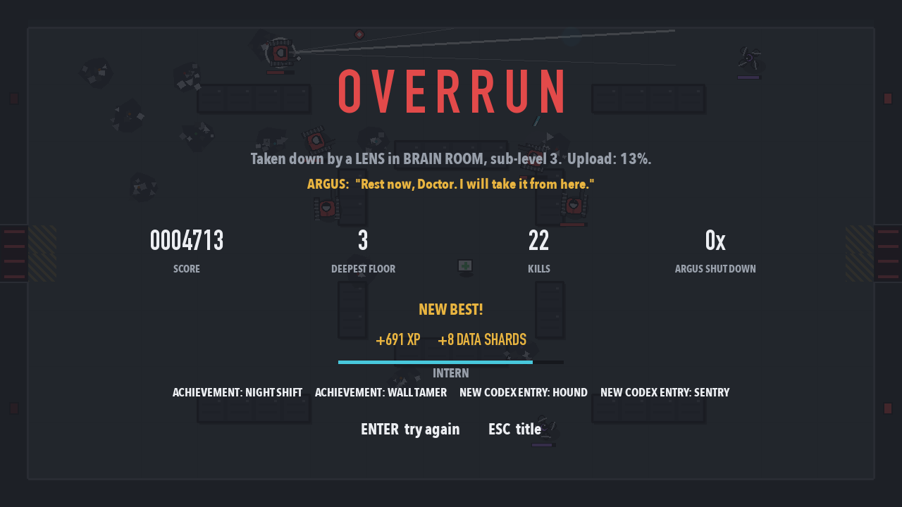 |

## Documents

| Document | What it covers |
|---|---|
| [docs/PROJECT_GUIDE.md](docs/PROJECT_GUIDE.md) | **Start here for the code**: the architecture, one frame step by step, every AI technique, each robot's state machine, and an index of every file and function |
| [docs/GAME_DESIGN.md](docs/GAME_DESIGN.md) | the design, the AI architecture and the evaluation |
| [docs/LORE.md](docs/LORE.md) | Kestrel Data Center, ARGUS, the robot models, copies and generations |
| [docs/GAMIFICATION.md](docs/GAMIFICATION.md) | game loops, rewards, research, achievements and dynamic difficulty |
| [docs/PROPOSALS.md](docs/PROPOSALS.md) | ideas evaluated during development: evolving robots, 3D, and the browser build |
| [docs/NAMES.md](docs/NAMES.md) | how the title was chosen |

## Credits

Made by **Mohammed Hirez** (BSc in Artificial Intelligence and Machine Learning) for
[CS4096 Artificial Intelligence for Games](https://bookofmodules.ul.ie/Default.aspx?ModuleCodeParameter=%7CCS4096%7C),
University of Limerick, Autumn 2026.

Built with Python and [pygame-ce](https://pyga.me). The browser build uses
[pygbag](https://github.com/pygame-web/pygbag) and runs on Cloudflare Workers. Fonts: Barlow and
IBM Plex Mono, under the SIL Open Font License (see `game/assets/fonts/`).
