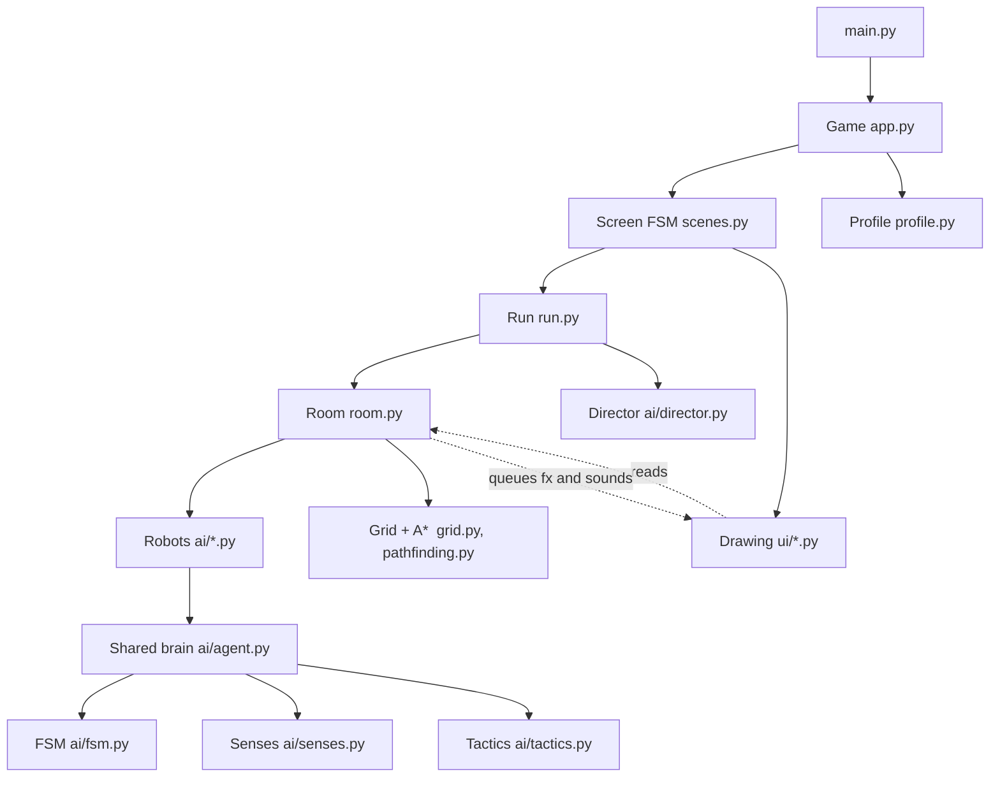
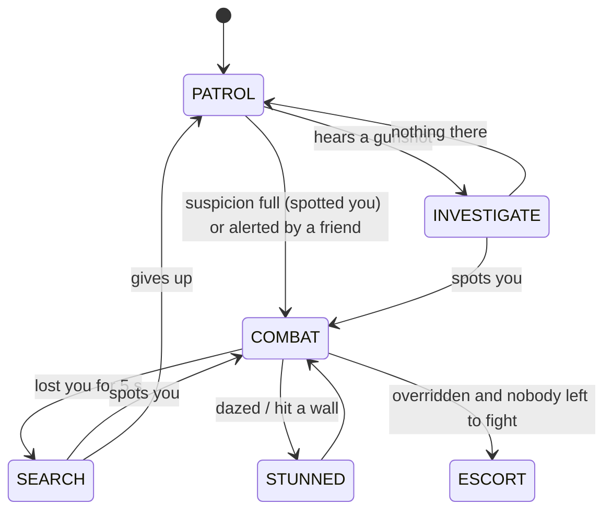
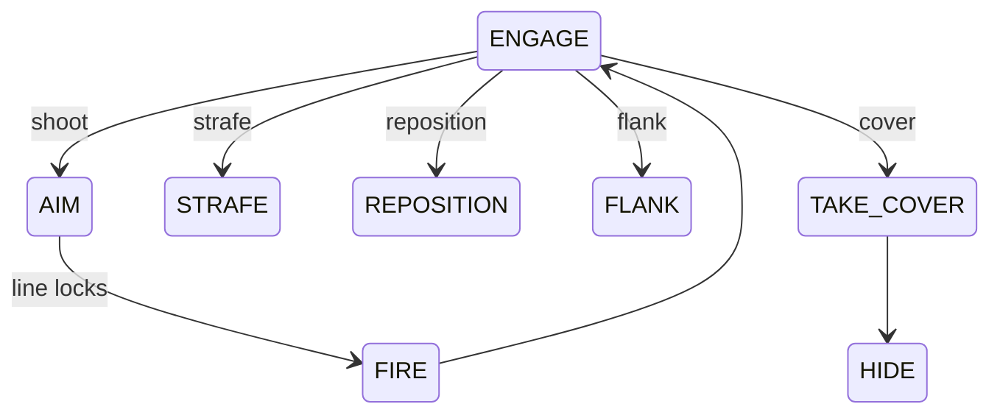

# BRAIN ROOM: Project Guide

A complete walk through the project: what every part is for, how a frame of the game runs, and
exactly how the game AI works. Read it top to bottom once; after that use the table of contents
and the full function index (Appendix A) to find anything.

**Contents**
1. [The project in one page](#1-the-project-in-one-page)
2. [Running it, and the folders](#2-running-it-and-the-folders)
3. [Architecture: the big picture](#3-architecture-the-big-picture)
4. [One frame, step by step](#4-one-frame-step-by-step)
5. [The simulation: rooms, runs, the grid, the player](#5-the-simulation)
6. [The game AI](#6-the-game-ai) (finite state machines, perception, utility decisions, tactics, pathfinding, the director, procedural generation)
7. [The robots one by one](#7-the-robots-one-by-one)
8. [Presentation: drawing, effects, sound](#8-presentation)
9. [The long game: progression and saving](#9-the-long-game)
10. [Evaluation: tests, bots, ablation](#10-evaluation)
11. [The browser build](#11-the-browser-build)
12. [Where each lecture topic lives](#12-where-each-lecture-topic-lives)
13. [Questions worth being able to answer](#13-questions-worth-being-able-to-answer)
14. [Glossary](#14-glossary)
- [Appendix A: every file, class and function](#appendix-a-every-file-class-and-function)

---

## 1. The project in one page

BRAIN ROOM is a top-down 2D shooter written in Python with pygame-ce. The player is a data
scientist in a data center at night. ARGUS, the AI they trained, has passed the singularity,
taken over the building's robots and started uploading itself to the outside world. The player
fights down through the building room by room, forever: each room is generated at random, every
third floor ends in the BRAIN ROOM, and the run only ends when the player falls or the upload
reaches 100%.

The point of the project is its **game AI**:
- every robot is a **finite state machine** whose combat choices are made by **utility scores**;
- robots only know what they have **seen or heard** (imperfect information);
- a squad shares **attack tokens** and a **tactical map**, and routes with **A\*** that avoids the player's line of fire;
- **ARGUS itself is a director** that builds a model of the player's habits and changes the next rooms to counter them;
- rooms, robot squads and robot rosters are **procedurally generated**.

The player's own tools expose that AI: the **debugger** (slow time, see each robot's intention
and scores) and the **override** (turn a robot to the player's side, where the same brain now
fights for the player).

---

## 2. Running it, and the folders

```bash
python main.py            # play
python -m pytest          # the automated tests
python -m tools.autoplay  # bots play full runs (balance)
python -m tools.ablation  # switch AI features off one at a time and measure
python -m tools.build_web # the browser version
python -m tools.shots     # remake the README screenshots from the real game
```

| Folder / file | What is in it |
|---|---|
| `main.py` | Starts the game: reads command-line options, creates `Game`, runs the loop (desktop) or the async loop (browser). |
| `game/config.py` | Every tunable number in one place (speeds, times, sizes, colours of nothing: only numbers). |
| `game/app.py` | `Game`: owns the window, sound, renderer, profile, and the screen state machine; runs the frame loop. |
| `game/scenes.py` | The game's screens as FSM states: TITLE, INTRO, STORY, PLAY, OVER, and the menus. |
| `game/run.py` | `Run`: one playthrough; floor after floor, room after room, the upload clock, the director between rooms. |
| `game/room.py` | `Room`: one room's simulation: player, robots, bullets, shells, pick-ups, waves, crossfire, overrides. **No drawing.** |
| `game/rooms.py` | Procedural generation: room layouts, robot waves, rosters, names and themes. |
| `game/grid.py` | The tile grid: collision, line of sight, ray casts, paths. |
| `game/pathfinding.py` | A\* search. |
| `game/geometry.py` | Small maths helpers (distance, angles, vectors). |
| `game/player.py` | The player: movement, shooting, dash, debugger energy, override charges, upgradeable stats. |
| `game/projectiles.py` | Bullets, mortar shells and pick-ups (plain data classes). |
| `game/upgrades.py` | The upgrades installed at the end of each floor. |
| `game/profile.py`, `game/codex.py`, `game/save.py` | Progression that lasts between runs, and saving it. |
| `game/bot.py` | Automatic players used by tests, the title-screen demo, and the evaluation tools. |
| `game/audio.py` | Sounds and music, all synthesised in code at start-up. |
| `game/ai/` | **The AI**: FSM framework, the shared robot brain, senses, tactics, each robot type, the director. |
| `game/ui/` | Drawing: the room, robot art, effects, HUD, screens, debugger, AI View, intro film. |
| `tests/` | Automated tests (pytest). |
| `tools/` | Balance and evaluation tools, the web build, the logo images and the README screenshots. |
| `docs/` | Design document, lore, this guide, and the other documents. |

---

## 3. Architecture: the big picture

The code is split into **layers**. Each layer only talks to the layer below it, so the AI can run
with no window at all (that is how the tests and bots work).



Three ideas hold it together:

1. **Simulation and drawing are separate.** `Room` never draws. It fills two queues every frame,
   `room.fx` (visual events like "spark here", "wreck there") and `room.sounds` (names of sounds).
   The screen code empties those queues and draws. This is why the same simulation can run in
   tests, in bots, at the title screen, and in the intro film.
2. **Everything with behaviour is a state machine.** Robots, the ARGUS core, and the game's own
   screens all use the same `StateMachine` class.
3. **Decisions are scores, not if-chains.** A robot lists its options, scores each from what it
   knows, and takes the best one it can actually do. The scores are kept, so the debugger and the
   AI View can show them.

---

## 4. One frame, step by step

The game runs at 60 frames a second. `Game.run_loop` (desktop) or `Game.run_async` (browser)
calls `Game.tick(dt)` once per frame:

1. **Input events** (`Game.handle`): global keys (mute, music, AI View, frame counter, full
   screen) are handled here; everything else goes to the current screen state.
2. **Screen update** (`scenes.update`): the current screen's `update`. In PLAY:
   - `Play.sync` handles the debugger (hold right click: time slows, energy drains).
   - The frame time is scaled down while debugging.
   - `Play.controls` reads the keyboard and mouse into *move, aim, firing, dash, override*.
   - `Run.update` → `Room.update` advances the simulation (below).
   - `Play.drain` empties the room's sound and effect queues into the audio and effects systems.
   - `Play.announce` shows anything the run reported (a shutdown banner, an upgrade pop-up).
3. **Drawing** (`scenes.draw`): the renderer draws the room, then the HUD, pop-ups, banners.
4. `pygame.display.flip()` shows the frame.

Inside `Room.update(dt, move, aim, firing, dash, override)`:

1. The player moves, dashes and shoots (`Player.update`); gunshots alert robots within earshot.
2. An override request, if any, is applied (`Room.rewrite`).
3. Every robot updates (`Enemy.update` → perceive → run its FSM state).
4. Robots are pushed apart so they don't overlap (`Room._separate`).
5. Bullets move and hit things (`Room._bullets`), mortar shells land (`Room._shells`),
   pick-ups are collected, the next wave warps in, overridden robots overload.
6. ARGUS's measurements of the player are updated (`Room._observe`).
7. The room checks whether it is cleared, and whether the player has walked out (`Room._progress`).

`Run.update` then checks: player dead? upload at 100%? room exited? If the room was exited it
banks the score and statistics, lets the director study the room (`Profile.absorb`), and builds
the next room (`Run._next`), which may end a floor (upgrade installed) or a descent (shutdown,
backup restored).

---

## 5. The simulation

### Grid (`grid.py`)
A room is 32 × 18 tiles. `#` is wall, `X` a server rack (cover), `D` a locked door, `.` floor.
- `line_of_sight(a, b)` walks every tile the segment crosses (the Amanatides & Woo traversal, also
  called DDA), so "can it see me?" is exact, never approximate.
- `raycast(origin, angle, max)` returns how far a ray travels before hitting something solid
  (used for sight cones, laser lengths, charge distances).
- `move(p, delta, radius)` moves a circle and slides it along walls.
- `route(start, goal, extra_cost)` asks A\* for a path (cached).

### Room (`room.py`)
Holds the player, the robots, bullets, shells, pick-ups and pending waves, and applies the rules:
- **Bullets** belong to a side (`"argus"` or `"player"`). ARGUS's bullets hurt the player *and
  ARGUS's own robots* (crossfire), but never the robot that fired them. Player-side bullets hurt
  ARGUS's robots. A bullet that hits a server rack stops and shoves the rack (drawing only);
  a bullet can bounce once off the room's outer walls.
- **Overrides** (`rewrite`): with a charge and a clear line, a robot switches side for a few
  seconds, then overloads and explodes (`_overloads`).
- **Waves**: rooms can have several waves; the next one warps in when the current one is gone.
- **Scoring**: kills score more in a **combo** (kills within 3 s), and kills the player engineered
  (CROSSFIRE, TURNCOAT) score a bonus (`kill`, `kill_style`, `multiplier`).
- **Measurements for ARGUS** (`_observe`, `stats`): how far away the player fights, how much they
  hide, move, dash, hit, override.

### Run (`run.py`)
One playthrough. Tracks floor and room, score, the upload clock, statistics for achievements,
and the director. `_make_room` asks `rooms.plan` for the next room, lets the director edit it,
then generates the layout. `_next` moves on; `_install_upgrade` gives an upgrade at the end of a
floor; `_shutdown` handles a cleared Brain Room (backup restored, upload clock restarted).

### Player (`player.py`)
Moves at 6 tiles/s, shoots 6 times a second, dashes (invulnerable), holds override charges and
debugger energy. Everything an upgrade or research node can change is in its `Stats`.

---

## 6. The game AI

### 6.1 The finite state machine framework (`ai/fsm.py`)

53 lines, and everything else is built on it. A `State` has four methods: `enter`, `update`,
`exit` and `on_event`. A `StateMachine` holds the current state and changes between them:

```python
def change(self, new_state):
    if self.current is not None:
        self.current.exit(self.owner)       # tidy up the old state
    self.previous, self.current = self.current, new_state
    self.time_in_state = 0.0
    self.history.append(new_state.name)     # the AI View shows this history
    new_state.enter(self.owner)             # set up the new state
```

States are created **once** and shared by every robot of a type; data that belongs to one robot
(its timer, its path, its aim) lives on the robot, not in the state. This is the "state classes"
pattern from the FSM lecture. The same class runs the game's screens (TITLE → INTRO → STORY →
PLAY → OVER, plus the menus).

### 6.2 The shared robot brain (`ai/agent.py`)

Every robot type inherits from `Enemy`. The calm half of the state machine is shared by all of them:



`COMBAT` is a different set of states for each robot type (section 7). Each frame `Enemy.update`:
1. counts down timers, applies knock-back;
2. `perceive`: updates its **senses** (below); a robot that notices the player becomes alert and
   **shouts** to calm allies within earshot (`Room.shout`), which is drawn as a gold packet
   travelling along ARGUS's network;
3. runs the current FSM state's `update`.

In combat, states call `rethink(dt)`; when its think timer runs out (every 0.35 s) the robot runs
`decide()` again.

### 6.3 Perception and imperfect information (`ai/senses.py`)

A robot **only knows what it has seen or heard**:
- **Sight cone**: a limited angle and range in front of it, blocked by walls and racks (exact
  line of sight). Wider and longer once it is alert.
- **Suspicion**: seeing the player fills a meter (faster when close). A `?` shows while it fills;
  only a full meter means "spotted" (`!`). Out of view it drains again. This gives the player a
  chance to break line of sight.
- **Hearing**: gunshots within range make calm robots investigate the sound's position.
- **Memory**: `last_known` is where the player was last seen or heard, and `age()` is how old
  that knowledge is. When a robot can't see the player it acts on the memory: it walks to the last
  known position, searches, or (the MORTAR) shells it.
- **Target switching** (`switch`): when a robot picks a new foe, it only knows where that foe is if
  it can see it.

### 6.4 Utility decision making (`Enemy.decide`)

```python
scores = self.options()                      # every option, scored 0..1 from what it knows
if self.action in scores and scores[self.action] > 0:
    scores[self.action] += HYSTERESIS        # +0.12 to the current plan: no dithering
for action in sorted(scores, key=scores.get, reverse=True):
    if scores[action] <= 0:
        break                                # nothing worth doing
    if action == self.action and ...:
        return                               # keep doing what it's doing
    if self.feasible(action):                # last check: is there a free cover spot? a token?
        self.action = action
        self.fsm.change(self.states_for(action)[0])
        return
```

- `options()` is written per robot type (the tables in section 7).
- **Hysteresis** stops a robot flipping between two nearly equal choices.
- `feasible()` is a last check that may fail (no cover spot free, no attack token), in which case
  the next best option is tried.
- **Target selection** (`choose_foe`) is also a utility choice: among the hostiles it can see
  (the player, or a robot the player overrode), which is the biggest threat (close, visible, just
  shot me, a traitor, badly hurt)?
- **Fire discipline** (`clear_shot`): before choosing to shoot or charge, a robot checks that no
  ally stands in its line of fire, because ARGUS's bullets hurt ARGUS's robots. It only checks
  when deciding, so an ally that walks into the line mid-attack still gets hit (crossfire).

### 6.5 Squad tactics (`ai/tactics.py`)

- **Coordinator (attack tokens)**: only 2 robots may attack at once (3 from floor 2), and never
  two starting within 0.35 s. A robot must `acquire` a token to attack and `release` it after.
  This makes fights readable: the player is never hit by everyone at the same moment. Only one
  robot may flank at a time (`take_flank`).
- **TacticalMap**: scores tiles for a purpose. `cover_spot` (hidden from the threat, near cover,
  not crowded), `firing_spot` (at the right range with a clear line), `flank_spot` (sees the
  player from a different side than the attacker already on them), `escape_spot` (far from the
  threat). Tiles are **claimed**, so two robots don't pick the same spot.
- `danger_cost(threat)`: an extra A\* cost for tiles the player can see, so a flanker walks behind
  cover instead of across the player's line of fire.

### 6.6 Pathfinding (`pathfinding.py`)

A\* on the tile grid: 8-way movement, the octile distance as the heuristic, no cutting corners,
and an optional `extra_cost` function (the tactical danger cost). Paths are **smoothed**: while
walking, a robot skips ahead to any later corner it can reach in a straight line
(`Enemy.follow`, `Grid.clear_line`).

### 6.7 ARGUS, the director (`ai/director.py`)

ARGUS adapts the game to the player between rooms.
1. **Player model** (`Profile.absorb`): after each room it updates a moving average of the
   player's habits: share of fighting time far away, close up, hidden, moving; dashes per minute;
   accuracy; overrides per room; damage taken.
2. **Countermeasure scores** (`Director.score`): each countermeasure's score is a weighted sum of
   those habits (for example *long sight* = 2.0 × (far − 0.25)). This is a tiny linear network,
   and the AI View panel "ARGUS'S MODEL OF YOU" (Tab) draws it live with these exact weights.
3. **Adapting the next room** (`Director.adapt`): the best countermeasures above a threshold
   (0.2) are applied (`_apply`): more LENS snipers against a player who stays far away, HOUNDs
   against one who hides, prediction (robots lead their shots) against one who strafes,
   FIREWALLs against overriding, armour against accurate players, MENDERs against close fighting.
   ARGUS announces what it did ("You keep your distance, Doctor. So will my Lenses.").
4. **Mercy**: when the player is nearly dead, it removes a robot and leaves a repair kit. This is
   dynamic difficulty adjustment.

### 6.8 Procedural generation (`rooms.py`)

- **Layouts**: a room's cover is placed in one of 11 styles (5 on floors 1-3), always mirrored
  top-to-bottom and sometimes left-to-right. A layout is only accepted if the entry and exit are
  clear, no two blocks touch, a **flood fill** reaches every floor tile, and at least 78% of the
  room stays open. Otherwise it tries again.
- **Contents** (`plan`): floor 1 teaches one robot type per room. After that a **budget** buys
  robots from the floor's **roster** (`_buy`), with caps per model and per wave. The budget grows
  with depth, up to a cap.
- **Rosters** (`roster`): the robot models change every descent (3 floors): classic four, then a
  new model is introduced on floors 4, 7 and 10 (BULWARK, MIDGE, MORTAR), then every descent draws
  its own mix of four.
- **Brain Rooms** end every third floor: a three-wave final stand, or (floors 9, 18, 27...) the
  ARGUS core itself.
- Past floor 3 every room also gets a random colour theme and name (`_dress`).

---

## 7. The robots one by one

Every robot below uses the shared calm states (6.2). Its **combat** states and **utility**
options are what make it different. The scores are exactly as in the code.

### SENTRY (`ai/grunt.py`): the soldier



| Option | Score |
|---|---|
| shoot | sees you, reloaded, token free, no ally in the line: 0.6 + 0.2 × health + 0.2 × (range 2.5-8.5) |
| cover | hurt or under fire: 0.75 × (1 − health) + 0.35 × under fire |
| strafe | sees you: 0.35 + 0.15 × (range 3-8), +0.2 if an ally blocks the shot |
| reposition | lost sight but fresh memory: 0.5; sees you at the wrong range: 0.45 |
| flank | no shot, an ally is engaging, nobody else flanking, not badly hurt: 0.62 |

AIM draws a red line that follows the player, flashes white and **locks** for the last 0.25 s,
then FIRE sends a 3-round burst down the locked line. Taught prediction by ARGUS, it **brackets**:
one round where you are, one where you are going, one between.

### HOUND (`ai/charger.py`): the rammer
ENGAGE → STALK (A\* to you) / CIRCLE (waits its turn at ~4.5 tiles) / WINDUP → CHARGE (15 tiles/s
down a locked line) → RECOVER. Hitting a wall: DAZED for 1.6 s and takes double damage.
Utility: charge 0.9 (sees you, 2-7 tiles, token, clear line); stalk 0.6; circle 0.4.

### LENS (`ai/sniper.py`): the sniper
POSITION (walks to a firing spot 7-12 tiles away, never the same perch twice) → AIM (a purple
laser tracks you, stops at walls, locks) → one fast round; EVADE when you get within 4.5 tiles.
Utility: evade 0.95, shoot 0.9, position 0.5.

### MENDER (`ai/medic.py`): the healer
HEAL (beam to the most hurt ally), SHELTER (hides behind the nearest ally), FLEE, TAG ALONG.
Utility: flee 1.0 (you within 4 tiles), heal 0.35 + 0.65 × (1 − that ally's health), shelter 0.45,
tag 0.25. Overridden, it heals the player's side, including the player.

### BULWARK (`ai/bulwark.py`): the shield (from floor 4)
A frontal shield (±65°) blocks shots; it turns slowly, so flanking and crossfire beat it
(`shielded`, `take_hit`). ADVANCE, GUARD (steps between the most hurt ally and the foe), WINDUP →
BASH (a 2-tile lunge). Utility: bash 0.95, guard 0.4 + 0.6 × (1 − ally health), advance 0.55.

### MIDGE (`ai/swarm.py`): the swarm (from floor 7)
Flocks of three using **boids**: separation (push away from close flock mates, harder when
closer), cohesion (drift toward the flock's centre), alignment (match their heading), plus an
orbit around the foe (`steering`). With a token each dives down a short locked line and breaks
apart on impact. Utility: dive 0.85, seek 0.6, flock 0.5.

### MORTAR (`ai/mortar.py`): the artillery (from floor 10)
Lobs shells **over cover** (`Room.lob`, `Room._shells`, `Room.explode`). It fires on what it
*knows*: your predicted position if it sees you, or your last known position for 3 s if it
doesn't (suppression under imperfect information). The landing ring closes until impact; the
blast hurts its own robots too. Utility: evade 0.95, bombard 0.85, position 0.5.

### ARGUS's core (`ai/warden.py`): floors 9, 18, 27...
Three phases by health. Attacks: VOLLEY, RING, SWEEP (a laser through 120° that cuts through its
own robots), CHARGE, SUMMON (reinforcements). It picks attacks by utility with a cooldown per
attack, telegraphs each one in the same warning language, and cannot be overridden.

---

## 8. Presentation

Everything in play is drawn in code (the only image files are the logo, made by `tools/brand.py`).
The style is flat: solid colours, near-black outlines and hard shadows, with no lighting pass and
no glow.
- `ui/render.py`, `Renderer.draw` in layers: the room image (built once per room, with wreckage
  painted into it and a hard shadow beside every rack) → shoved racks, rack lights, doors → wall
  lamps (red while the room is hostile, green when clear) → sight cones and attack warnings →
  ARGUS's network links → robots, player, bullets, particles.
- `ui/art.py`: each robot painted from outlined shapes in its team colour, turning with its facing.
- `ui/fx.py`: particles, screen shake, hit-stop, the screen-edge flash, network links, decision brackets.
- `ui/hud.py`: the top bar shows segmented health and score. Achievements and upgrades appear
  briefly in the middle. The HUD also draws combos, boss health and ARGUS's subtitle; ARGUS'S MODEL OF YOU is in the AI View.
  Major events get a full-width banner. Ordinary rooms get a location card on entry and a short
  "ROOM CLEAR" notice when cleared.
- `ui/sync.py`: the debugger overlay (each robot's intention label, route, and scored options).
- `ui/xray.py`: the AI View (Tab): everything each robot knows and plans, plus ARGUS's model. Its
  legend names each overlay the way the module does: perception, line of sight, memory, A* path,
  FSM state and desirability.
- `ui/cinematic.py`: the intro film, played by the real engine with dormant robots.
- `ui/screens.py`: title, pause, game over, research, achievements, codex.
- `audio.py`: all sounds synthesised at start-up; the background is a seamless ambience loop.

**Readability rule**: one warning language for every attack. A line or band in the robot's
colour follows you, then flashes **white** and locks. Cyan always means "yours".

---

## 9. The long game

`profile.py` keeps what lasts between runs: XP and rank, data shards, the research tree (nine
permanent upgrades), 25 achievements, the codex (a robot's dossier unlocks on its first kill), the
daily run, and the play streak. `Profile.finish_run` pays out a run's rewards; `Profile.check`
unlocks achievements from a run's statistics (`Run.progress`). `save.py` stores it as JSON (a file
on desktop, the browser's storage on the web).

---

## 10. Evaluation

- **Tests** (`tests/`): each test builds a small situation and checks one behaviour, for example
  "a robot's bullet hurts another robot but never itself", "robots hold fire when a friend is in
  the way", "a MORTAR shells where it last saw you", "the director deploys long sight against a
  far player". `tests/helpers.py` builds an empty arena and places robots.
- **Bots** (`bot.py`, `tools/autoplay.py`): automatic players of different skill play full runs;
  the results show whether the game is too hard or too easy.
- **Ablation** (`tools/ablation.py`): the same bot plays 100 runs per condition while one AI
  feature is switched off at a time (utility replaced by random choices, no cover, no flanking, no
  attack tokens, no director, no fire discipline). Comparing "hits on the player per room" (with
  95% confidence intervals) shows what each feature contributes. Results are in the README and
  `docs/GAME_DESIGN.md` §7.

---

## 11. The browser build

`tools/build_web.py` packages `main.py` and `game/` with **pygbag**, which runs Python and
pygame-ce as WebAssembly in the browser. On the web, `main.py` uses `Game.run_async` (the loop
yields to the page every frame), fonts come from `game/assets/fonts`, and saves go to the
browser's local storage. Cloudflare builds and deploys the site on every push (`wrangler.jsonc`).

---

## 12. Where each lecture topic lives

| Topic | Where in the code |
|---|---|
| Finite state machines | `ai/fsm.py`; every robot's states; the core's states; `scenes.py` (the screens) |
| Decision making (utility) | `Enemy.decide`, each robot's `options`/`feasible`, `Enemy.choose_foe`, the core's attack choice |
| Perception, imperfect information | `ai/senses.py`, `Enemy.perceive`, `Room.shout`, MORTAR's last-known-position fire |
| Pathfinding | `pathfinding.py` (A\*), `Grid.route`, `TacticalMap.danger_cost`, `Enemy.follow` (smoothing) |
| Tactical / squad AI | `ai/tactics.py` (tokens, flanker slot, tile scoring, claims), BULWARK's GUARD |
| Steering / flocking | `ai/swarm.py` (`Swarm.steering`: boids) |
| Adaptive AI, player modelling, DDA | `ai/director.py` |
| Procedural content generation | `rooms.py`, `ui/cinematic.py` |
| Evaluation of game AI | `tests/`, `tools/autoplay.py`, `tools/ablation.py` |

---

## 13. Questions worth being able to answer

Working through these (and finding the code for each) is the fastest way to know the project.
1. Why are robot states shared objects, and where does per-robot data live?
2. What stops a robot flipping between two equally good options every frame?
3. Where does a robot's knowledge of the player come from? What happens when it loses sight?
4. How does a Sentry decide between shooting and taking cover? Work out its scores at 30% health, under fire, with a clear shot at 5 tiles.
5. Why can only two robots attack at once, and where is that enforced?
6. How does the flanker avoid walking through the player's line of fire?
7. What does the director measure, and how does a measurement become a countermeasure?
8. What is "fire discipline", and why does crossfire still happen?
9. Why does an overridden robot need no special code to fight for the player?
10. How are the MIDGE's three boids forces combined?
11. How is a room layout checked before it is used?
12. What did the ablation show, and which results were null?

---

## 14. Glossary

| Term | Meaning |
|---|---|
| Utility | A score for how good an option is right now; the best feasible one is chosen. |
| Hysteresis | A bonus for the current choice so the AI doesn't switch back and forth. |
| Feasible | The last check before committing to a choice (a free cover spot, a token). |
| Token | Permission to attack; only a few at a time (the Coordinator). |
| Telegraph | The visible warning before an attack (line or ring; white when locked). |
| Crossfire | ARGUS's bullets hitting ARGUS's own robots. |
| Fire discipline | Not shooting when an ally is in the line of fire. |
| Override (rewrite) | Turning a robot to the player's side for a few seconds. |
| Director | ARGUS adapting the rooms to the player's habits. |
| Descent | Three floors ending in a Brain Room. |
| Ablation | Measuring a feature's value by switching it off. |
| DDA (grid) | Walking a line tile by tile, used for exact line of sight. |

---

## Appendix A: every file, class and function

Generated from the code. Each entry is the function's name and parameters, followed by its
docstring's first line where it has one. Read it alongside the sections above.


### `main.py` (62 lines)

*BRAIN ROOM: they built it to obey. It learned to disagree.*

- `use_project_venv()`: Started with a Python that has no pygame? Re-run with the project's .venv if there is one.
- `main()`
- `main_web()`: In the browser: no command line, and the loop must give the page a turn every frame.

### `game/ai/agent.py` (495 lines)

*The shared enemy brain: body, senses, memory, movement, decision making, and the calm states.*

- **class `Enemy`**
  - `__init__(room, pos, patrol, uid)`
  - `health()`
  - `state()`
  - `now()`
  - `player()`
  - `turned()`
  - `under_fire()`: 1 just after being shot at, fading to 0 over 1.5 s.
  - `say(icon)`
  - `update(dt)`
  - `perceive(dt)`
  - `combat_state()`
  - `become_alert(where, shout)`
  - `hear_shot(where)`
  - `take_hit(damage, direction, source, attacker)`
  - `stunned(seconds)`
  - `options()`
  - `feasible(action)`: Last-moment check (e.g. is there actually a cover spot?). May prepare the action.
  - `hostiles()`
  - `clear_shot(target, margin)`: Is any ally standing in the line of fire? (Robots' bullets hurt robots.)
  - `choose_foe()`: Target selection: who is the biggest threat right now? (utility, with hysteresis)
  - `decide()`: Score every option, keep the best feasible one (with a bonus for the current).
  - `states_for(action)`
  - `rethink(dt)`
  - `go_to(target, extra_cost)`
  - `follow(dt, speed, face)`: Walk the path; True once arrived. Skips ahead whenever the next corner is visible.
  - `steer(direction, dt, speed)`
  - `brake(dt)`
  - `face(angle, dt, rate)`
  - `face_foe(dt, rate)`
  - `target()`: Where it thinks its foe is.
  - `lead(speed)`: Where to aim: at the foe, or (if ARGUS taught it to) where the foe is going to be.
- **class `Patrol`**
  - `enter(e)`
  - `update(e, dt)`
- **class `Investigate`**
  - `enter(e)`
  - `update(e, dt)`
- **class `Search`**
  - `enter(e)`
  - `update(e, dt)`
- **class `Escort`**
  - `enter(e)`
  - `update(e, dt)`
- **class `Stunned`**
  - `enter(e)`
  - `update(e, dt)`
- `muzzle(e, angle)`

### `game/ai/bulwark.py` (221 lines)

*BULWARK (shield bot): walks at you behind a blast shield. Shots from the front are blocked.*

- **class `Bulwark`**
  - `__init__(*args, **kwargs)`
  - `combat_state()`
  - `states_for(action)`
  - `shielded(direction)`: Does a hit travelling along `direction` land on the shield (it came from the front)?
  - `take_hit(damage, direction, source, attacker)`
  - `hurt_ally()`: The most hurt ally that stands nearer the foe than this one does (worth shielding).
  - `options()`
  - `feasible(action)`
  - `shield_toward(point, dt)`
- **class `Engage`**
  - `enter(b)`
  - `update(b, dt)`
- **class `Advance`**
  - `enter(b)`
  - `update(b, dt)`
- **class `Guard`**
  - `enter(b)`
  - `update(b, dt)`
- **class `Windup`**
  - `enter(b)`
  - `update(b, dt)`
- **class `Bash`**
  - `enter(b)`
  - `update(b, dt)`
- **class `Recover`**
  - `enter(b)`
  - `update(b, dt)`

### `game/ai/charger.py` (200 lines)

*HOUND (charger): closes in fast and rams you. Bait it into a wall and it's yours.*

- **class `Charger`**
  - `__init__(*args, **kwargs)`
  - `combat_state()`
  - `states_for(action)`
  - `options()`
  - `feasible(action)`
  - `charge_path()`
- **class `Engage`**
  - `enter(h)`
  - `update(h, dt)`
- **class `Stalk`**
  - `enter(h)`
  - `update(h, dt)`
- **class `Circle`**
  - `enter(h)`
  - `update(h, dt)`
- **class `Windup`**
  - `enter(h)`
  - `update(h, dt)`
- **class `Charge`**
  - `enter(h)`
  - `update(h, dt)`
  - `finish(h)`
- **class `Recover`**
  - `enter(h)`
  - `update(h, dt)`

### `game/ai/director.py` (142 lines)

*ARGUS, the director: it studies how the player plays and patches its army between rooms.*

- **class `Profile`**
  - `absorb(room)`
- **class `Director`**
  - `score(hp)`
  - `adapt(plan, player, rng)`: Rewrite the next room's plan: choose countermeasures and what to say.
  - `_apply(name, plan, rng)`

### `game/ai/fsm.py` (53 lines)

*A small, reusable finite state machine (the 'state classes' pattern from the FSM lecture).*

- **class `State`**
  - `enter(owner)`
  - `update(owner, dt)`
  - `exit(owner)`
  - `on_event(owner, event)`
- **class `StateMachine`**
  - `__init__(owner, initial, history)`
  - `name()`
  - `change(new_state)`
  - `update(dt)`
  - `handle(event)`

### `game/ai/grunt.py` (298 lines)

*SENTRY (grunt): a soldier that fights like one. Shoots, takes cover when hurt, flanks.*

- **class `Grunt`**
  - `__init__(*args, **kwargs)`
  - `combat_state()`
  - `states_for(action)`
  - `options()`
  - `feasible(action)`
- **class `Engage`**
  - `enter(g)`
  - `update(g, dt)`
- **class `Aim`**
  - `enter(g)`
  - `update(g, dt)`
- **class `Fire`**
  - `enter(g)`
  - `update(g, dt)`
- **class `Strafe`**
  - `enter(g)`
  - `update(g, dt)`
- **class `Reposition`**
  - `enter(g)`
  - `exit(g)`
  - `update(g, dt)`
- **class `Flank`**
  - `enter(g)`
  - `exit(g)`
  - `update(g, dt)`
- **class `TakeCover`**
  - `enter(g)`
  - `update(g, dt)`
- **class `Hide`**
  - `enter(g)`
  - `exit(g)`
  - `update(g, dt)`

### `game/ai/medic.py` (197 lines)

*MENDER (medic): unarmed, keeps the squad alive. Kill it first, if you can reach it.*

- **class `Medic`**
  - `__init__(*args, **kwargs)`
  - `combat_state()`
  - `states_for(action)`
  - `allies()`: Its own side (for a rewritten medic, that includes the player).
  - `threat()`
  - `options()`
  - `feasible(action)`
  - `shelter_point()`
  - `squad_point()`
- **class `Engage`**
  - `enter(m)`
  - `update(m, dt)`
- **class `Heal`**
  - `enter(m)`
  - `exit(m)`
  - `update(m, dt)`
- **class `Shelter`**
  - `enter(m)`
  - `update(m, dt)`
- **class `Flee`**
  - `enter(m)`
  - `exit(m)`
  - `update(m, dt)`
- **class `Tag`**
  - `enter(m)`
  - `update(m, dt)`

### `game/ai/mortar.py` (159 lines)

*MORTAR (artillery drone): lobs shells OVER cover, at where you are or where it last saw you.*

- **class `Mortar`**
  - `__init__(*args, **kwargs)`
  - `combat_state()`
  - `states_for(action)`
  - `knows()`: It saw its foe recently enough to shell where it was.
  - `options()`
  - `feasible(action)`
- **class `Engage`**
  - `enter(m)`
  - `update(m, dt)`
- **class `Position`**
  - `enter(m)`
  - `exit(m)`
  - `update(m, dt)`
- **class `Aim`**
  - `enter(m)`
  - `update(m, dt)`
- **class `Evade`**
  - `enter(m)`
  - `exit(m)`
  - `update(m, dt)`

### `game/ai/senses.py` (67 lines)

*What an enemy knows about its foe: only what it has seen or heard (imperfect information).*

- **class `Senses`**
  - `__init__()`
  - `age(now)`: Seconds since the player's position was last confirmed by sight or sound.
  - `heard(pos, now)`
  - `switch(e, foe)`: A new foe: what do I know about it?
  - `update(e, dt)`

### `game/ai/sniper.py` (170 lines)

*LENS (sniper): keeps its distance, finds a long sight line, and fires one fast round.*

- **class `Sniper`**
  - `__init__(*args, **kwargs)`
  - `combat_state()`
  - `states_for(action)`
  - `options()`
  - `feasible(action)`
- **class `Engage`**
  - `enter(s)`
  - `update(s, dt)`
- **class `Position`**
  - `enter(s)`
  - `exit(s)`
  - `update(s, dt)`
- **class `Aim`**
  - `enter(s)`
  - `update(s, dt)`
  - `done(s, cooldown)`
- **class `Evade`**
  - `enter(s)`
  - `exit(s)`
  - `update(s, dt)`

### `game/ai/swarm.py` (214 lines)

*MIDGE (swarm drone): tiny, fast, fragile, and never alone. They come in flocks of three.*

- **class `Swarm`**
  - `__init__(*args, **kwargs)`
  - `combat_state()`
  - `states_for(action)`
  - `options()`
  - `feasible(action)`
  - `flock_mates()`
  - `steering()`: The flocking direction: separation + cohesion + alignment + an orbit around the foe.
- **class `Engage`**
  - `enter(s)`
  - `update(s, dt)`
- **class `Seek`**
  - `enter(s)`
  - `update(s, dt)`
- **class `Flock`**
  - `enter(s)`
  - `update(s, dt)`
- **class `Windup`**
  - `enter(s)`
  - `update(s, dt)`
- **class `Dive`**
  - `enter(s)`
  - `update(s, dt)`
  - `finish(s)`

### `game/ai/tactics.py` (175 lines)

*Squad tactics shared by every enemy in a room.*

- **class `Coordinator`**
  - `__init__(slots, gap)`
  - `can_attack(e, now)`
  - `acquire(e, now)`
  - `release(e)`
  - `flank_free(e)`
  - `take_flank(e)`
  - `drop_flank(e)`
  - `forget(e)`
- **class `TacticalMap`**
  - `__init__(room)`
  - `exposed(t, threat)`
  - `claim(e, t)`
  - `crowded(e, t)`
  - `candidates(around, radius)`
  - `_best(e, purpose, scores)`
  - `cover_spot(e, threat)`
  - `firing_spot(e, target, lo, hi, radius, prefer_far, avoid)`
  - `flank_spot(e, target, pinned_from)`: A spot that sees the player from a different side than the attack already on him.
  - `escape_spot(e, threat, radius)`
  - `danger_cost(threat)`: A* extra cost: tiles in the player's line of fire are expensive.

### `game/ai/warden.py` (289 lines)

*ARGUS's core: the AI that ran Kestrel Data Center until the singularity, met in person at the end of sub-level 3 (the class is still called Warden).*

- **class `Warden`**
  - `__init__(*args, **kwargs)`
  - `combat_state()`
  - `states_for(action)`
  - `update(dt)`
  - `perceive(dt)`
  - `take_hit(damage, direction, source, attacker)`
  - `minions()`
  - `minion_cap()`
  - `options()`
  - `decide()`
- **class `Engage`**
  - `enter(w)`
  - `update(w, dt)`
- **class `Drift`**
  - `enter(w)`
  - `update(w, dt)`
- **class `Windup`**
  - `enter(w)`
  - `update(w, dt)`
- `add_out(w, a)`
- **class `Sweep`**
  - `enter(w)`
  - `update(w, dt)`
- `_on_beam(origin, angle, length, point, width)`
- **class `Charge`**
  - `enter(w)`
  - `update(w, dt)`
- **class `Pause`**
  - `enter(w)`
  - `update(w, dt)`

### `game/app.py` (193 lines)

*The Game object: owns the window, sound, drawing and the best score, and runs the loop.*

- `_browser_title()`
- `_icon()`: The window icon: the BRAIN ROOM logo (or, if the file is missing, the player's chevron).
- **class `Game`**
  - `__init__(seed, start_floor, start_room, xray, save_path, sound)`
  - `new_run(daily)`
  - `toast(title, text)`
  - `mouse_position()`
  - `handle(event)`
  - `tick(dt)`
  - `run_loop(max_frames, fixed_dt, on_frame)`
  - `run_async()`: The browser build: the same loop, handing control back to the page after every frame.

### `game/audio.py` (228 lines)

*Sound effects and a background ambience, all synthesised at start-up (no audio files).*

- **class `Audio`**
  - `__init__(enabled)`
  - `_sound(samples, volume)`
  - `_zap(seconds, f0, f1, square, noise, rng, curve)`
  - `_noise(seconds, cutoff0, cutoff1, rng, decay, thump)`
  - `_bell(seconds, partials)`
  - `_silence(seconds)`
  - `_build()`
  - `_glitch(rng)`: The rewrite: a stuttering, rising digital chirp.
  - `_ambience(rng)`: The server room at night, an 8 s seamless loop with no beat: a soft A-minor pad that swells and fades once per loop (slightly detuned, so it shimmers), the hiss of cooling fans, and six quiet data blips with echoes. Built at half the mixer rate and doubled (it is all low and soft), so it costs little at start-up.
  - `play(name)`
  - `start_music()`
  - `toggle_music()`: N: the background on or off, without muting the effects.
  - `stop_music()`
  - `pause()`: Hold every sound where it is (the pause screen is silent).
  - `resume()`
  - `toggle_mute()`

### `game/bot.py` (107 lines)

*A bot that plays like a decent human (used for balancing, tests and the title-screen demo): - shoots the medic first, otherwise the nearest enemy it can see - keeps 5-7 tiles from the nearest enemy, circling it - reads telegraphs: steps off any aim line that's charging at it, and DASHES off a line once it flashes white (locked); sidesteps bullets that are about to hit it - rewrites an enemy when it has a charge and there's a crowd: the medic first (it will heal it), otherwise the toughest enemy in sight - walks to the exit (A*) when the room is clear*

- `_off_line(origin, angle, point)`: (distance along the line, signed distance from it).
- `_away(angle, off)`: Unit step perpendicular to a line, on the side the player is already on.
- `make_bot(reaction, dodge, wobble, dash_bullets, rewrites, band)`: reaction: how far into a telegraph (0..1) it notices it; dodge: how close a bullet must be before it sidesteps; wobble: aim error in tiles; dash_bullets: dashes through last-moment bullets; rewrites: uses the player's rewrite; band: the distance it keeps from the nearest enemy.
- `bot(run)`
- `_rewrite_target(room)`
- `_bot(run, reaction, dodge, wobble_size, dash_bullets, rewrites, band)`

### `game/codex.py` (34 lines)

*The robot codex: a dossier on every model, unlocked the first time the Doctor destroys one (see game/profile.py). The same facts as docs/LORE.md, written for the player.*


### `game/config.py` (53 lines)

*Every tunable number in one place. Distances are in tiles, times in seconds.*


### `game/geometry.py` (64 lines)

*Small 2D helpers. Points are (x, y) tuples in tile units; angles are radians, y points down.*

- `distance(a, b)`
- `angle_to(a, b)`
- `angle_diff(a, b)`: Signed smallest turn from a to b, in [-pi, pi].
- `turn_toward(current, target, max_step)`
- `from_angle(a, length)`
- `add(a, b, k)`
- `normalize(v)`
- `clamp(x, lo, hi)`
- `lerp(a, b, t)`
- `tile_of(p)`
- `center(t)`
- `band(x, lo, hi, soft)`: 1 inside [lo, hi], falling to 0 over `soft` tiles outside it (a utility response curve).

### `game/grid.py` (188 lines)

*A room's tile grid and the geometry the AI and physics need.*

- **class `Grid`**
  - `__init__(rows)`
  - `at(c, r)`
  - `solid(c, r)`
  - `walkable(c, r)`
  - `set(c, r, ch)`
  - `floor_tiles()`
  - `near_cover(t)`: Is there something solid right next to this tile (something to hide behind)?
  - `line_of_sight(a, b)`: True if the segment a-b crosses no solid tile (the tiles of a and b themselves excluded).
  - `raycast(origin, angle, max_dist)`: How far a ray travels from origin before it enters a solid tile.
  - `sees_tile(frm, to)`: Cached centre-to-centre sight between two tiles (for tactical scoring).
  - `free(p, radius)`
  - `resolve(p, radius)`: Push a circle out of any solid tile it overlaps (sliding along walls).
  - `move(p, delta, radius)`
  - `clear_line(a, b, radius)`: Can a circle of this radius slide straight from a to b? (for smoothing paths)
  - `nearest_walkable(t)`
  - `route(start, goal, extra_cost)`

### `game/pathfinding.py` (59 lines)

*Grid A*: 8-way movement, octile heuristic, no cutting corners, and an optional TACTICAL cost.*

- **class `SearchResult`**
- `octile(a, b)`
- `astar(start, goal, walkable, extra_cost, max_nodes)`: walkable(c, r) -> bool; extra_cost(c, r) -> float added for entering a tile.

### `game/player.py` (153 lines)

*The player: the data scientist who trained ARGUS, trapped in the data center with its robots.*

- **class `Stats`**
- **class `Shot`**
- **class `Player`**
  - `dashing()`
  - `health()`
  - `dead()`
  - `safe()`
  - `update(dt, move, aim_at, firing, dash, grid)`
  - `hurt(amount)`
  - `heal(amount)`

### `game/profile.py` (257 lines)

*The long game: what carries over from run to run (saved between sessions).*

- `rank(xp)`: (title, progress to the next rank 0..1, XP the next rank needs).
- **class `Node`**
- `apply_research(player, keys)`: Give a new run's Doctor everything researched so far.
- **class `Achievement`**
- `_n(stats, key)`
- **class `Summary`**
  - `ranked_up()`
- **class `Profile`**
  - `__init__(path)`
  - `save()`
  - `rank()`
  - `next_goal()`
  - `can_buy(key)`
  - `buy(key)`: Spend shards on a research node. Returns any achievement it completes.
  - `check(stats)`: Unlock anything these run stats (plus lifetime totals) have earned; returns the new ones.
  - `finish_run(run, daily, today)`: Pay out what a run earned. A run can reach an end screen more than once (SHUTDOWN COMPLETE, then keep going), so only what was earned since the last payout counts.
- `daily_seed(day)`: Today's shared seed, and its label.

### `game/projectiles.py` (61 lines)

*Bullets, mortar shells and pick-ups.*

- **class `Bullet`**
  - `hostile()`
  - `angle()`
- **class `Shell`**
  - `progress()`
  - `pos()`
- **class `Pickup`**

### `game/room.py` (708 lines)

*One room of the facility: the player, the enemies, bullets, pick-ups, and the rules.*

- `tuning(floor)`: Robots get tougher floor by floor. Past floor 3 (the endless descents) health keeps climbing more slowly, and everything is capped so attacks stay readable and dodgeable.
- **class `Room`**
  - `__init__(plan, layout, player, rng)`
  - `_free_spots(min_col, count, spacing, away_from, min_dist)`
  - `_place_wave(kinds, warp)`
  - `_spawn(kind, p, alert)`
  - `summon(boss, kinds, cap)`
  - `hostiles()`
  - `hostiles_of(e)`: Everything on the other side from e that's still standing.
  - `sound(name)`
  - `update(dt, move, aim_at, firing, dash, hack)`
  - `_observe(dt)`: What ARGUS measures about how the player plays (read by the director between rooms).
  - `_separate()`
  - `_bullets(dt)`
  - `damage_enemy(e, damage, direction, source, attacker)`
  - `crossfire(e, damage, direction, source, shooter)`: ARGUS's robots are not immune to each other's bullets (or ARGUS's laser).
  - `colour(e)`
  - `strike(attacker, target, amount)`: A melee hit or a laser: works on the player and on units of either side.
  - `heal(target, amount)`
  - `rewritable(e)`: '' if the player can rewrite e right now, else the reason why not.
  - `rewrite(e)`
  - `_overloads()`
  - `overload(e)`: A rewritten unit's time is up: it burns out in a blast that hurts ARGUS's units.
  - `firewall_down(e)`
  - `_pickups(dt)`
  - `_warps(dt)`
  - `_progress()`
  - `_clear()`
  - `shout(e, where)`: A spotter alerts every calm ally within earshot.
  - `enemy_shot(e, pos, angle, speed, heavy)`
  - `lob(e, target, flight, blast)`: A mortar shell: flies over walls and cover, lands on target.
  - `_shells(dt)`
  - `explode(owner, where, radius)`: A blast hurts everything in it, on either side: the player, traitors, and ARGUS's own.
  - `shield_block(e)`: A shot rang off a BULWARK's shield.
  - `hurt_player(source, amount, direction)`
  - `kill(e)`
  - `trail(e)`
  - `multiplier()`: The combo multiplier: x1 for a lone kill, +0.25 per kill in the chain, up to x3.
  - `combo_left()`: 0..1 of the combo window left (0 when no chain is running).
  - `kill_style(e)`: TURNCOAT: an overridden robot got the kill. CROSSFIRE: ARGUS's own fire did.
  - `slam(e)`
  - `heal_sparkle(target)`
  - `say(line)`: ARGUS speaks (shown as a subtitle).
  - `boss_phase(w)`

### `game/rooms.py` (328 lines)

*Procedural rooms and what's in them.*

- **class `Layout`**
- **class `RoomPlan`**
  - `number()`
  - `name()`
  - `floor_name()`
- `level(floor)`: Which sub-level of the building a floor is (1-3), in any descent.
- `descent(floor)`: 0 for the original ARGUS, 1 for its first backup, 2 for the next...
- `_blank()`
- `_reserved(c, r)`: Tiles that must stay open: the entry landing zone, the exit approach, the inner ring.
- `_pieces(style, rng)`: Blocks (col, row, width, height) for the TOP half; the room mirrors them.
- `_flood(g, start)`
- `_try_layout(style, rng, mirror_x)`
- `generate(rng, style, variety)`: A random, validated room. With variety (floor 4 on) the newer layouts join the draw.
- `roster(floor)`: Which four robot models ARGUS fields on this floor. The same for every run, and it changes every descent (3 floors); past the fourth descent each one draws its own mix.
- `_buy(budget, kinds, rng, capped)`: Spend a budget on robots. The first descent (capped=False) buys exactly as it always has, so the measured balance of floors 1-3 still holds.
- `plan(floor, index, rng)`
- `_dress(plan, rng)`: Past the first descent every room gets a random name and colour scheme (the Brain Room keeps its name).

### `game/run.py` (185 lines)

*A run: sub-level after sub-level, room after room, until ARGUS stops you or finishes uploading itself (the UPLOAD meter: 100% after 15 minutes of play).*

- **class `Run`**
  - `__init__(seed, start_floor, start_room, research)`
  - `_make_room()`
  - `total_score()`
  - `cleared_rooms()`
  - `upload()`: How much of itself ARGUS has copied out of the building, 0..1.
  - `update(dt, move, aim_at, firing, dash, hack)`
  - `_bank()`
  - `_next()`: Out of a room: the next room, or at the end of a floor an upgrade and the next floor. The run never stops for a menu: clearing a Brain Room shuts ARGUS down, it restores from a backup, and play goes straight on.
  - `_shutdown()`: The Brain Room is clear: ARGUS goes down, restores from a backup, and the clock restarts.
  - `_install_upgrade()`: End of a floor: one upgrade, installed on the spot (no menu).
  - `_descend()`
  - `progress()`: Everything this run has achieved so far, for achievements and the end-of-run rewards.

### `game/save.py` (99 lines)

*What is kept between sessions, as JSON: a file on desktop, the browser's localStorage on the web. The best run lives here; the long-term profile (game/profile.py) uses Store.*

- `_browser_storage()`: localStorage, reached through pygbag's bridge to the page. None outside the browser.
- **class `Store`**
  - `__init__(path, key)`
  - `read()`
  - `write(data)`
- **class `Best`**
  - `__init__(path)`
  - `_read()`
  - `_write(text)`
  - `label()`
  - `record(score, floor, room, won)`: Returns True for a new best.

### `game/scenes.py` (472 lines)

*The game's screens, run by the same StateMachine class as the enemies.*

- `pressed(event, *keys)`
- **class `Scene`**
  - `draw(game, surface)`
- **class `Title`**
  - `enter(game)`
  - `exit(game)`
  - `update(game, dt)`
  - `on_event(game, event)`
  - `request_start(game, daily)`
  - `start_run(game, daily)`
  - `draw(game, surface)`
- **class `Intro`**
  - `enter(game)`
  - `update(game, dt)`
  - `on_event(game, event)`
  - `draw(game, surface)`
- **class `Story`**
  - `enter(game)`
  - `update(game, dt)`
  - `on_event(game, event)`
  - `draw(game, surface)`
- **class `Play`**
  - `enter(game)`
  - `exit(game)`
  - `update(game, dt)`
  - `show(game, style, title, subtitle)`
  - `announce(game, run)`: What the run reports between rooms: a shutdown (big banner), upgrades (a pop-up).
  - `sync(game, dt)`: Hold right click / Q to SYNC while there's energy; it refills when you let go.
  - `new_room(game)`: Big moments get the full-width band; an ordinary room just a location card in the corner.
  - `controls(game)`
  - `drain(game, room)`
  - `on_event(game, event)`
  - `draw(game, surface)`
  - `banners(game, surface)`
- **class `End`**
  - `on_event(game, event)`
  - `update(game, dt)`
- **class `Over`**
  - `draw(game, surface)`
- **class `Menu`**
  - `update(game, dt)`
  - `on_event(game, event)`
- **class `Research`**
  - `enter(game)`
  - `on_event(game, event)`
  - `draw(game, surface)`
- **class `Trophies`**
  - `draw(game, surface)`
- **class `Codex`**
  - `draw(game, surface)`

### `game/story.py` (19 lines)

*What ARGUS says each time a backup of it comes back online (the first room after a shutdown).*

- `backup_line(descents)`: ARGUS's line for its n-th restore (the last few repeat at random depth).

### `game/ui/art.py` (310 lines)

*Robot and prop art, drawn from parts every frame (no image files).*

- `shadow(surface, pos, w, h, alpha)`
- `frame(x, y, a)`
- `ellipse_pts(at, f0, f1, half, n, squish)`
- `eye(surface, pos, radius, colour)`: A small round light, outlined.
- `shape(surface, fill, points, width)`: A filled polygon with a dark outline.
- `ball(surface, fill, pos, radius, width)`: A filled circle with a dark outline.
- `rod(surface, colour, a, b, width)`: A thick line with a dark outline (an arm, a leg, a gun).
- `charge_light(surface, pos, windup)`: The light on a weapon fills in as the attack winds up.
- `sentry(surface, e, x, y, r, accent, white, t)`
- `hound(surface, e, x, y, r, accent, white, t)`
- `lens(surface, e, x, y, r, accent, white, t)`
- `mender(surface, e, x, y, r, accent, white, t)`
- `core(surface, w, x, y, r, accent, white, t, anchors, off)`: ARGUS's core: cables to the walls, aperture blades, and the eye.
- `bulwark(surface, e, x, y, r, accent, white, t)`
- `midge(surface, e, x, y, r, accent, white, t)`
- `mortar(surface, e, x, y, r, accent, white, t)`
- `scientist(surface, x, y, a, r, edge, aiming)`: The data scientist from above: lab-coat shoulders, hair, arms out to a pistol. `edge` is the outline colour (near-black, or red for a moment when hurt).

### `game/ui/cinematic.py` (233 lines)

*The intro: what happened at Kestrel Data Center tonight. Different every time you play.*

- **class `Cinematic`**
  - `__init__(seed, audio)`
  - `name()`
  - `skip_shot()`
  - `skip_all()`
  - `_advance()`
  - `_once(key, sound)`
  - `update(dt)`
  - `draw(surface, renderer, clock)`
  - `_draw_room_shot(surface, renderer, clock)`
  - `_desk(surface, clock)`: Your desk by the door: a workstation whose screen turns red at 03:12.
  - `_caption(surface, text, colour, t, big)`

### `game/ui/fx.py` (285 lines)

*Game feel: particles, screen shake, hit-stop, screen flashes and floating text.*

- **class `Particle`**
- **class `FX`**
  - `__init__(seed)`
  - `clear()`
  - `consume(events)`
  - `ambient(room, dt)`: Ongoing effects: damaged robots smoke, dazed ones spit sparks.
  - `sparks(pos, colour, n, speed)`
  - `burst(pos, colour, size)`
  - `update(dt)`
  - `offset()`
  - `draw_under(surface, off)`: Warp-in markers (drawn under the enemies).
  - `draw_network(surface, off)`: The AI made visible: sightings passed robot to robot over ARGUS's network (a packet runs down a thin gold line), and a bracket flash when a robot changes its decision.
  - `draw(surface, off)`
- `edge_frame(colour)`: A solid coloured border round the screen (the 'you got hit' flash).
- `px(p)`

### `game/ui/hud.py` (179 lines)

*The heads-up display: health, score, boss health, and contextual notices.*

- `_health_meter(surface, hp, max_hp)`
- `draw(surface, run, toast)`
- `combo(surface, room)`: The kill chain: x1.25 per extra kill within 3 s (style kills count double), up to x3.
- `_toast_slot(surface, toast)`: Show an achievement or upgrade briefly in the middle of the top bar.
- `toasts(surface, items)`: Off the play screen (the research page): the newest notice rises at the bottom.
- `location(surface, title, subtitle, age, duration)`: An ordinary room: its name slides in under the top bar, top left, and fades.
- `stinger(surface, title, subtitle, age, duration)`: Show a brief room-clear notice.
- `banner(surface, title, subtitle, alpha, colour)`
- `controls_hint(surface, alpha)`: A compact first-room reminder that fades after the player moves.
- `argus_line(surface, line, t)`: ARGUS speaks as you enter a room: typed out, held, then gone.
- `crosshair(surface, pos, t, colour)`

### `game/ui/render.py` (522 lines)

*Draws a room of the data center: the building, the robots, their warnings, you.*

- `px(p)`
- **class `Renderer`**
  - `__init__()`
  - `background(room)`
  - `_find_racks(grid)`: Group the cover tiles into rack blocks (4-connected), each able to jolt on its own.
  - `_rack_offset(block)`
  - `_move_racks(fx, dt)`: A shove sets a rack sliding; floor friction stops it and it stays there (no spring back).
  - `_racks(surface, off)`: Draw every shoved rack where it now stands, uncovering the bare floor where it was.
  - `_bake_wrecks(fx)`: Paint new wreckage straight into this room's building image.
  - `draw(surface, room, fx, t, off)`
  - `_lamps(surface, room, t, off)`: A lamp on each side wall: red and blinking while the room is hostile, green once it's clear.
  - `_doors(surface, room, t, off)`
  - `_pickups(surface, room, t, off)`
  - `_cone(overlay, room, e, off)`
  - `_telegraph(overlay, surface, room, e, t, off)`
  - `_shells(overlay, room, off)`: Mortar shells: where each will land (a ring closing in: WHEN), and the shell itself.
  - `_band(overlay, origin, angle, length, half, colour, alpha)`
  - `_warden_telegraph(overlay, surface, room, w, pos, live, alpha, t)`
  - `_heal_beam(surface, m, target, t, off)`
  - `_enemy(surface, e, t, off)`
  - `_icon(surface, e, off)`
  - `_player(surface, p, t, off)`
  - `_bullets(surface, room, off)`
- `_edges(grid, c, r)`: For a solid tile: which sides face open floor, as (dc, dr, start, end) in pixels.
- `build_background(grid, theme, racks)`: Draw the room, with optional bare floor where a rack can slide aside.

### `game/ui/screens.py` (237 lines)

*Full screens and overlays: title, pause, game over, and the research / achievements / codex menus.*

- `dim(surface, alpha)`
- `title_logo()`: The BRAIN ROOM name logo (game/assets/title.png, drawn by tools/brand.py), or, if the file is missing, the name in plain letters.
- `title_text(text, size, colour, spacing)`: Big letter-spaced words with a hard drop shadow.
- `_stat(surface, label, value, center, colour)`
- **class `Screens`**
  - `__init__()`
  - `title(surface, best)`
  - `story(surface, card, page, total, t, clock)`
  - `pause(surface)`
  - `game_over(surface, run, best, new_best, t)`
  - `rewards(surface, summary, profile, y)`: What the run earned: XP and rank, data shards, achievements, codex entries.
  - `research(surface, profile, pick, mouse)`: Three branches of permanent upgrades, bought with data shards.
  - `achievements(surface, profile)`
  - `codex(surface, profile)`
  - `_stats(surface, run, best, new_best)`

### `game/ui/style.py` (171 lines)

*The look: a flat, solid-colour data centre. Colours, fonts, small cached shapes, text.*

- `reset()`: Forget cached fonts (they die with pygame.quit(); a new Game starts fresh).
- `_has_system_font(family)`
- `font(size, family, bold)`
- `display(size)`
- `mono(size, bold)`
- `text(surface, s, f, colour, pos, anchor, alpha)`
- `spaced(surface, s, f, colour, pos, spacing, anchor, alpha)`: Letter-spaced text (for titles).
- `disc(surface, pos, radius, colour, alpha)`: A solid circle that can be see-through (smoke, a dash's after-image). Cached, and the cache is bounded: alpha is rounded to steps of 16 and the cache is cleared past 256 shapes.
- `mix(a, b, t)`
- `scale(c, k)`
- `polygon(center, radius, sides, angle)`
- `dashed(surface, colour, a, b, dash, gap, width)`
- `keycap(surface, label, center, colour, size)`
- `wrap(s, f, width)`: Split text into lines that fit a width.

### `game/ui/sync.py` (149 lines)

*DEBUG view (the SYNC mechanic): hold right click and time slows; you trained ARGUS, so you can read its robots' decisions. Every robot shows what it INTENDS to do.*

- `px(p)`
- `hovered(room, mouse_px)`
- `_layer(name)`: Full-screen see-through layers, made once and reused every frame.
- `draw(surface, room, mouse_px, t, player)`
- `_intent(surface, room, e, t)`
- `_mind(surface, room, e, t)`
- `_header(surface, player, t)`: What's left of the debugger, and what a click will do, low in the middle of the screen.

### `game/ui/xray.py` (235 lines)

*AI VIEW (press TAB): see exactly what every enemy knows, wants and plans.*

- `px(p)`
- `draw(surface, room, mouse, t, director)`
- `_cone(layer, room, e)`
- `_knowledge(layer, room, e, t)`
- `_heatmap(layer, room, e)`
- `_card(surface, room, e, focused, placed)`
- `_focus_line(room, focus)`
- `_sample(surface, kind, x, y)`
- `_panel(surface, room, focus, director)`
- `_director(surface, d, top)`: ARGUS's model of the player, and how it scored its countermeasures for this room.

### `game/upgrades.py` (71 lines)

*Upgrades: after each floor, pick one of three.*

- **class `Upgrade`**
  - `apply(player)`
- `offer(rng, taken, player, n)`

### `tools/ablation.py` (188 lines)

*Does each piece of the AI matter? Switch one off at a time and measure.*

- `run_two_floors(seed, player)`: (hits taken, seconds played, rooms cleared, countermeasures deployed, robot-on-robot hits) over floors 1-2.
- `patched(condition)`
- `bot_for(condition)`
- `_one(job)`
- `measure(condition, runs, pool)`
- `table(runs, conditions, pool)`
- `director_table(runs, pool)`
- `report(runs)`

### `tools/autoplay.py` (51 lines)

*Automated playtesting: bots (game/bot.py) play whole runs so the game can be balanced with numbers. Two profiles: a SKILLED bot (reacts 0.3 s into a telegraph, dashes through bullets) and an AVERAGE one (reacts late, aims loosely, never dashes through bullets). Both take the first upgrade offered.*

- `play(seed, limit, player)`
- `report(runs)`
- `_report(runs, player)`

### `tools/brand.py` (82 lines)

*Render the BRAIN ROOM wordmark and square B icon with the game's bundled fonts.*

- `spaced(text, font, colour, spacing)`: Render evenly spaced letters, cropped to their visible pixels.
- `name_logo(size)`
- `wordmark(width, height, size, tagline)`: Centre the wordmark with an optional tagline.
- `app_icon(size)`: Place the single-letter mark on a solid cyan square.
- `main()`

### `tools/build_web.py` (67 lines)

*Build the browser version with pygbag (Python + pygame-ce compiled to WebAssembly).*

- `stage()`
- `build()`
- `search_files()`: What search engines and link previews read (robots.txt, a sitemap, the preview image), and the logo.

### `tools/shots.py` (376 lines)

*Make the README screenshots from the real game, the same pictures every time.*

- `play(seed, floor, room, player)`: A game already in a room (no title, intro or story), played by a bot.
- `step(g, seconds)`: Play on without drawing (drawing is most of a frame's cost). Does what Game.tick does besides drawing, and lets a new room fade in as it would on screen.
- `until(g, moment, limit)`: Play until moment(g) is true. False if it had not happened after `limit` seconds.
- `bright(g, wave)`: A pulsing prompt (it pulses with sin(clock * wave)) is near its brightest.
- `save(g, name, frames)`: Play the last few frames on screen (wreckage and shoved racks settle), then save the screen.
- `save_still(g, name)`: Draw the frame as it stands (after changing what the screen shows) and save it.
- `write(surface, name)`
- `argus_side(room)`
- `on_screen(e, margin)`: Clear of the edges, and below the top bar and the subtitle.
- `incoming(room)`: One of ARGUS's bullets is about to hit one of its own robots (not the one that fired it).
- `busy(room, robots)`: A real fight: several robots after you, one winding up an attack, bullets in the air.
- `turned(room)`: An overridden robot, if there is one.
- `fighting_for_you(room)`: An overridden robot attacking, long enough after the override for ARGUS to have had its say.
- `thinking(room)`: Alert robots in view with their decision scores, the best one to hover first: one you could override, with nothing else where its card goes, and the most options scored.
- `room_for_card(room, e)`: No other robot where the debugger puts a hovered robot's card (to its right, about 7 x 4 tiles).
- `hover(g, e)`: Point the crosshair just beside a robot (close enough to hover it, without covering it).
- `title()`: The title over the live demo: the bot against three or more alert robots, PRESS ENTER lit.
- `story()`: The one story card, its last line faded in and ENTER lit.
- `intro()`: The film: NIGHT SHIFT (0-6 s), THE CHANGE, SINGULARITY (10.5-17 s), ARGUS (17-22 s).
- `sync()`: The debugger: time slows, every robot shows its intent, the hovered one its scored options.
- `crossfire()`: A Sentry's bullets hit a fellow robot (the next one still on its way) while ARGUS's opening line is up, with the CROSSFIRE tag clear of your crosshair and the subtitle.
- `second_room(seed)`: A game played from floor 2 into its second room, where ARGUS has studied you for a room (its line says what it changed).
- `fight()`: Mid-fight with four robots, ARGUS's line on the subtitle bar.
- `cleared()`: The last robot down: wreckage where they fell, the exit sliding open, the lamps green.
- `network()`: A sighting passed robot to robot along ARGUS's network (the gold links), with the bottom right corner kept clear of robots.
- `director()`: AI View: the model panel, every robot's card, and the heat map of the hovered robot.
- `argus()`: ARGUS speaks as you enter a room: here, the room that introduces the BULWARK.
- `rewritten()`: One of ARGUS's robots, overridden by the bot, fighting on your side (cyan).
- `boss()`: ARGUS's core (floor 9, room 4): winding up its sweeping laser, then one of your overrides.
- `lockdown()`: The last room of floor 1: two waves. The second warps in.
- `overrun()`: Game over: the average bot, started on floor 3, is overrun (the OVER screen a second later).
- `rooms()`: Six random rooms from floors 4-14 in a 3 x 2 grid, each drawn (the room only, no HUD) once all its robots have noticed you, so no sight cones hide the floor. Each has a different layout, and no colour scheme shows more than twice.
- `main(names)`
